# TMAG5273 Low-Power Linear 3D Hall-Effect Sensor With I²C Interface

**TMAG5273**
**SLYS045B – JUNE 2021 – REVISED JULY 2024**

---

## 1. Features

- Configurable power modes including:
  - 2.3mA active mode current
  - 1µA wake-up and sleep mode current
  - 5nA sleep mode current
- Selectable linear magnetic range at X, Y, or Z axis:
  - TMAG5273x1: ±40mT, ±80mT
  - TMAG5273x2: ±133mT, ±266mT
- Interrupt signal from user-defined magnetic and temperature threshold cross
- 5% (typical) sensitivity drift
- Integrated angle CORDIC calculation with gain and offset adjustment
- 20kSPS single axis conversion rate
- Configurable averaging up to 32x for noise reduction
- Conversion trigger by I²C or dedicated INT̅ pin
- Optimized I²C interface with cyclic redundancy check (CRC):
  - Maximum 1-MHz I²C clock speed
  - Special I²C frame reads for improved throughput
  - Factory-programmed and user-configurable I²C addresses
- Integrated temperature compensation for multiple magnet types
- Built-in temperature sensor
- 1.7-V to 3.6-V supply voltage V_CC range
- Operating temperature range: –40℃ to +125℃

## 2. Applications

- Electricity meters
- Electronic smart lock
- Smart thermostat
- Joystick & gaming controllers
- Drone payload control
- Door & window sensor
- Magnetic proximity sensor
- Mobile robot motor control
- E-bike

## 3. Description

The TMAG5273 is a low-power linear 3D Hall-effect sensor designed for a wide range of industrial and personal electronics applications. This device integrates three independent Hall-effect sensors in the X, Y, and Z axes. A precision analog signal-chain along with an integrated 12-bit ADC digitizes the measured analog magnetic field values. The I²C interface, while supporting multiple operating V_CC ranges, ensures seamless data communication with low-voltage microcontrollers. The device has an integrated temperature sensor available for multiple system functions, such as thermal budget check or temperature compensation calculation for a given magnetic field.

The TMAG5273 can be configured through the I²C interface to enable any combination of magnetic axes and temperature measurements. Additionally, the device can be configured to various power options (including wake-up and sleep mode) allowing designers to optimize system power consumption based on their system-level needs. Multiple sensor conversion schemes and I²C read frames help optimize throughput and accuracy. A dedicated INT̅ pin can act as a system interrupt during low power wake-up and sleep mode, and can also be used by a microcontroller to trigger a new sensor conversion.

An integrated angle calculation engine (CORDIC) provides full 360° angular position information for both on-axis and off-axis angle measurement topologies. The angle calculation is performed using two user-selected magnetic axes. The device features magnetic gain and offset correction to mitigate the impact of system mechanical error sources.

The TMAG5273 is offered in four different factory-programmed I²C addresses. The device also supports additional I²C addresses through the modification of a user-configurable I²C address register. Each orderable part can be configured to select one of two magnetic field ranges that suits the magnet strength and component placement during system calibration.

The device performs consistently across a wide ambient temperature range of –40°C to +125°C.

### Package Information

| PART NUMBER | PACKAGE         | PACKAGE SIZE  |
| ----------- | --------------- | ------------- |
| TMAG5273    | DBV (SOT-23, 6) | 2.9mm × 2.8mm |

> (1) For all available packages, see the package option addendum at the end of the data sheet.
> (2) The package size (length × width) is a nominal value and includes pins, where applicable.

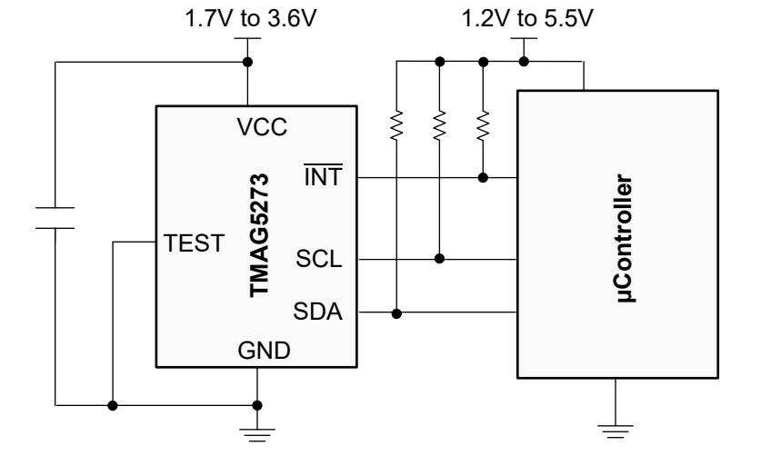

---

## 4 Pin Configuration and Functions

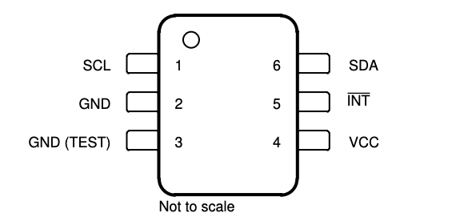

### Table 4-1. Pin Functions

| PIN NAME   | PIN NO. | TYPE         | DESCRIPTION                                                                      |
| ---------- | ------- | ------------ | -------------------------------------------------------------------------------- |
| SCL        | 1       | IO           | Serial clock.                                                                    |
| GND        | 2       | Ground       | Ground reference.                                                                |
| GND (TEST) | 3       | Input        | TI Test Pin. Connect to ground in application.                                   |
| VCC        | 4       | Power supply | Power supply.                                                                    |
| INT̅        | 5       | IO           | Interrupt input/output. If not used and connected to ground, set MASK_INTB = 1b. |
| SDA        | 6       | IO           | Serial data.                                                                     |

---

## 5. Specifications

### 5.1 Absolute Maximum Ratings

_over operating free-air temperature range (unless otherwise noted)_

|       |                              | MIN  | MAX       | UNIT |
| ----- | ---------------------------- | ---- | --------- | ---- |
| V_CC  | Main supply voltage          | –0.3 | 4         | V    |
| I_OUT | Output current, SDA, INT̅     | 0    | 10        | mA   |
| V_OUT | Output voltage, SDA, INT̅     | –0.3 | 7         | V    |
| V_IN  | Input voltage, SCL, SDA, INT̅ | –0.3 | 7         | V    |
| B_MAX | Magnetic flux density        |      | Unlimited | T    |
| T_J   | Junction temperature         | –40  | 150       | °C   |
| T_stg | Storage temperature          | –65  | 170       | °C   |

> (1) Operation outside the Absolute Maximum Ratings may cause permanent device damage. Absolute Maximum Ratings do not imply functional operation of the device at these or any other conditions beyond those listed under Recommended Operating Conditions. If used outside the Recommended Operating Conditions but within the Absolute Maximum Ratings, the device may not be fully functional, and this may affect device reliability, functionality, performance, and shorten the device lifetime.

### 5.2 ESD Ratings

|          |                         |                                                                           | VALUE | UNIT |
| -------- | ----------------------- | ------------------------------------------------------------------------- | ----- | ---- |
| V\_(ESD) | Electrostatic discharge | Human body model (HBM), per ANSI/ESDA/JEDEC JS-001, all pins ^(1)         | ±2000 | V    |
| V\_(ESD) | Electrostatic discharge | Charged device model (CDM), per JEDEC specification JS-002, all pins ^(2) | ±500  | V    |

> (1) JEDEC document JEP155 states that 500V HBM allows safe manufacturing with a standard ESD control process.
> (2) JEDEC document JEP157 states that 250V CDM allows safe manufacturing with a standard ESD control process.

### 5.3 Recommended Operating Conditions

_over operating free-air temperature range (unless otherwise noted)_
_over recommended V_CC range (unless otherwise noted)_

|               |                                   | MIN | NOM | MAX | UNIT |
| ------------- | --------------------------------- | --- | --- | --- | ---- |
| V_CC          | Main supply voltage               | 1.7 |     | 3.6 | V    |
| V_OUT         | Output voltage, SDA, INT̅          | 0   |     | 5.5 | V    |
| I_OUT         | Output current, SDA, INT̅          |     |     | 2   | mA   |
| V_IH          | Input HIGH voltage, SCL, SDA, INT̅ | 0.7 |     |     | V_CC |
| V_IL          | Input LOW voltage, SCL, SDA, INT̅  |     |     | 0.3 | V_CC |
| ΔV_CC/Δt ^(1) | Supply voltage ramp rate          | 3   |     |     | V/ms |
| T_A           | Operating free air temperature    | –40 |     | 125 | ℃    |

> (1) If the VCC ramp rate is slower than the recommended supply voltage ramp rate, run a wake-up and sleep cycle after power-up or power-up reset to avoid I²C address glitch during sleep mode. This action is not required while operating in stand-by or continuous modes.

### 5.4 Thermal Information

| THERMAL METRIC ^(1)                                    | TMAG5273, DBV (SOT-23), 6 pins | UNIT |
| ------------------------------------------------------ | ------------------------------ | ---- |
| R_θJA — Junction-to-ambient thermal resistance         | 162                            | °C/W |
| R_θJC(top) — Junction-to-case (top) thermal resistance | 81.6                           | °C/W |
| R_θJB — Junction-to-board thermal resistance           | 50.1                           | °C/W |
| Ψ_JT — Junction-to-top characterization parameter      | 30.7                           | °C/W |
| Ψ_JB — Junction-to-board characterization parameter    | 49.8                           | °C/W |

> (1) For more information about traditional and new thermal metrics, see the Semiconductor and IC Package Thermal Metrics application note.

### 5.5 Electrical Characteristics

_over operating free-air temperature range (unless otherwise noted)_
_over recommended V_CC range (unless otherwise noted)_

**SDA, INT̅**

| Parameter   | Parameter Description                         | TEST CONDITIONS                            | MIN | TYP | MAX  | UNIT |
| ----------- | --------------------------------------------- | ------------------------------------------ | --- | --- | ---- | ---- |
| V_OL        | Output LOW voltage, SDA, INT̅ pin              | I_OUT = 2mA                                | 0   |     | 0.4  | V    |
| I_OZ        | Output leakage current, SDA, INT̅ pin          | Output disabled, V_OZ = 5.5V               |     |     | ±100 | nA   |
| t_FALL_INT  | INT̅ output fall time                          | R_PU =10KΩ, C_L =20pF, V_PU =1.65V to 5.5V |     | 6   |      | ns   |
| t_INT (INT) | INT̅ Interrupt time duration during pulse mode | INT_MODE =001b or 010b                     |     | 10  |      | µs   |
| t_INT (SCL) | SCL Interrupt time duration                   | INT_MODE =011b or 100b                     |     | 10  |      | µs   |

**DC POWER SECTION**

| Parameter   |                                | TEST CONDITIONS                                         | MIN | TYP  | MAX | UNIT |
| ----------- | ------------------------------ | ------------------------------------------------------- | --- | ---- | --- | ---- |
| VCC_UV ^(1) | Undervoltage threshold at V_CC | V_CC = 2.3V to 3.6V                                     | 1.9 | 2.0  | 2.2 | V    |
| I_ACTIVE    | Active mode current            | X, Y, Z, or thermal sensor active conversion, LP_LN =0b |     | 2.3  |     | mA   |
| I_ACTIVE    | Active mode current            | X, Y, Z, or thermal sensor active conversion, LP_LN =1b |     | 3.0  |     | mA   |
| I_STANDBY   | Stand-by mode current          | Device in trigger mode, no conversion started           |     | 0.45 |     | mA   |
| I_SLEEP     | Sleep mode current             |                                                         |     | 5    |     | nA   |

**AVERAGE POWER DURING WAKE-UP AND SLEEP (W&S) MODE**

| Parameter |                                                                  | TEST CONDITIONS                           | MIN | TYP  | MAX | UNIT |
| --------- | ---------------------------------------------------------------- | ----------------------------------------- | --- | ---- | --- | ---- |
| I_CC_DCM  | W&S mode current consumption, Wake-up interval 1ms, LP_LN =0b    | Magnetic 1 channel conversion, V_CC =3.3V |     | 160  |     | µA   |
| I_CC_DCM  | W&S mode current consumption, Wake-up interval 1ms, LP_LN =0b    | Magnetic 1 channel conversion, V_CC =1.8V |     | 156  |     | µA   |
| I_CC_DCM  | W&S mode current consumption, Wake-up interval 1ms, LP_LN =0b    | Magnetic 4 channel conversion, V_CC =3.3V |     | 240  |     | µA   |
| I_CC_DCM  | W&S mode current consumption, Wake-up interval 1ms, LP_LN =0b    | Magnetic 4 channel conversion, V_CC =1.8V |     | 233  |     | µA   |
| I_CC_DCM  | W&S mode current consumption, Wake-up interval 5000ms, LP_LN =0b | Magnetic 1 channel conversion, V_CC =3.3V |     | 1.21 |     | µA   |
| I_CC_DCM  | W&S mode current consumption, Wake-up interval 5000ms, LP_LN =0b | Magnetic 1 channel conversion, V_CC =1.8V |     | 1.00 |     | µA   |
| I_CC_DCM  | W&S mode current consumption, Wake-up interval 5000ms, LP_LN =0b | Magnetic 4 channel conversion, V_CC =3.3V |     | 1.22 |     | µA   |
| I_CC_DCM  | W&S mode current consumption, Wake-up interval 5000ms, LP_LN =0b | Magnetic 4-channel conversion, V_CC =1.8V |     | 1.02 |     | µA   |

> (1) The DIAG_STATUS and VCC_UV_ER bits are not valid for V_CC < 2.3V

### 5.6 Temperature Sensor

_over operating free-air temperature range (unless otherwise noted)_
_over recommended V_CC range (unless otherwise noted)_

| Parameter    |                                                                        | TEST CONDITIONS | MIN | TYP   | MAX      | UNIT  |
| ------------ | ---------------------------------------------------------------------- | --------------- | --- | ----- | -------- | ----- |
| T_SENS_RANGE | Temperature sensing range                                              |                 | –40 |       | 170 ^(1) | ℃     |
| T_ADC_T0     | Temperature result in decimal value (from 16-bit format) for T_SENS_T0 |                 |     | 17508 |          |       |
| T_SENS_T0    | Reference temperature for T_ADC_T0                                     |                 |     | 25    |          | ℃     |
| T_ADC_RES    | Temp sensing resolution (in 16-bit format)                             |                 |     | 60.1  |          | LSB/℃ |
| NRMS_T       | RMS (1 Sigma) temperature noise                                        | CONV_AVG = 000b |     | 0.4   |          | ℃     |
| NRMS_T       | RMS (1 Sigma) temperature noise                                        | CONV_AVG = 101b |     | 0.2   |          | ℃     |

> (1) TI recommends not to exceed the specified Operating free air temperature per Recommended Operating Conditions table

### 5.7 Magnetic Characteristics For A1, B1, C1, D1

_over operating free-air temperature range (unless otherwise noted)_

| Parameter  |                                                           | TEST CONDITIONS       | MIN | TYP    | MAX    | UNIT   |
| ---------- | --------------------------------------------------------- | --------------------- | --- | ------ | ------ | ------ |
| B_IN       | Linear magnetic range for X, Y, and Z                     | \_RANGE = 0b          |     | ±40    |        | mT     |
| B_IN       | Linear magnetic range for X, Y, and Z                     | \_RANGE = 1b          |     | ±80    |        | mT     |
| SENS       | Sensitivity, X, Y, or Z axis                              | \_RANGE = 0b, ±40mT   |     | 820    |        | LSB/mT |
| SENS       | Sensitivity, X, Y, or Z axis                              | \_RANGE = 1b, ±80mT   |     | 410    |        | LSB/mT |
| SENS_ER    | Sensitivity error, X, Y, Z axis                           | T_A = 25°C            |     | ±5.0%  | ±20.0% |        |
| SENS_ER_DR | Sensitivity error drift from 25°C, X, Y, Z axis           |                       |     | ±5.0%  |        |        |
| SENS_LER   | Sensitivity linearity error, T_A = 25°C                   | X, Y Axis             |     | ±0.10% |        |        |
| SENS_LER   | Sensitivity linearity error, T_A = 25°C                   | Z Axis                |     | ±0.10% |        |        |
| SENS_MS    | Sensitivity mismatch, T_A = 25°C                          | X-Y axes              |     | ±0.50% |        |        |
| SENS_MS    | Sensitivity mismatch, T_A = 25°C                          | Y-Z, or X-Z axes      |     | ±1.0%  |        |        |
| SENS_MS_DR | Sensitivity mismatch drift                                | X-Y axes              |     | ±5%    |        |        |
| SENS_MS_DR | Sensitivity mismatch drift                                | Y-Z, or X-Z axes      |     | ±15%   |        |        |
| B_off      | Offset                                                    | T_A = 25°C            |     | ±300   | ±1000  | µT     |
| B_off_TC   | Offset drift                                              |                       |     | ±3.0   | ±10.0  | µT/°C  |
| N_RMS      | RMS (1 Sigma) magnetic noise, CONV_AVG = 000b, T_A = 25°C | LP_LN = 0b, X, Y Axis |     | 125    |        | µT     |
| N_RMS      | RMS (1 Sigma) magnetic noise, CONV_AVG = 000b, T_A = 25°C | LP_LN = 1b, X, Y Axis |     | 110    |        | µT     |
| N_RMS      | RMS (1 Sigma) magnetic noise, CONV_AVG = 101b, T_A = 25°C | LP_LN = 0b, X, Y Axis |     | 22     |        | µT     |
| N_RMS      | RMS (1 Sigma) magnetic noise, CONV_AVG = 101b, T_A = 25°C | LP_LN = 1b, X, Y Axis |     | 22     |        | µT     |
| N_RMS      | RMS (1 Sigma) magnetic noise, CONV_AVG = 000b, T_A = 25°C | LP_LN = 0b, Z Axis    |     | 68     |        | µT     |
| N_RMS      | RMS (1 Sigma) magnetic noise, CONV_AVG = 000b, T_A = 25°C | LP_LN = 1b, Z Axis    |     | 66     |        | µT     |
| N_RMS      | RMS (1 Sigma) magnetic noise, CONV_AVG = 101b, T_A = 25°C | LP_LN = 0b, Z Axis    |     | 11     |        | µT     |
| N_RMS      | RMS (1 Sigma) magnetic noise, CONV_AVG = 101b, T_A = 25°C | LP_LN = 1b, Z Axis    |     | 9      |        | µT     |
| A_ERR      | Angle error, CONV_AVG = 101b, T_A = 25°C                  | Y-Z                   |     | ±1.0   |        | Degree |
| A_ERR      | Angle error, CONV_AVG = 101b, T_A = 25°C                  | X-Z                   |     | ±1.0   |        | Degree |
| A_ERR      | Angle error, CONV_AVG = 101b, T_A = 25°C                  | X-Y                   |     | ±0.5   |        | Degree |

### 5.8 Magnetic Characteristics For A2, B2, C2, D2

_over operating free-air temperature range (unless otherwise noted)_

| Parameter  |                                                           | TEST CONDITIONS       | MIN | TYP    | MAX    | UNIT   |
| ---------- | --------------------------------------------------------- | --------------------- | --- | ------ | ------ | ------ |
| B_IN       | Linear magnetic range for X, Y, and Z                     | \_RANGE = 0b          |     | ±133   |        | mT     |
| B_IN       | Linear magnetic range for X, Y, and Z                     | \_RANGE = 1b          |     | ±266   |        | mT     |
| SENS       | Sensitivity, X, Y, or Z axis                              | \_RANGE = 0b, ±133mT  |     | 250    |        | LSB/mT |
| SENS       | Sensitivity, X, Y, or Z axis                              | \_RANGE = 0b, ±266mT  |     | 125    |        | LSB/mT |
| SENS_ER    | Sensitivity error, X, Y, Z axis                           | T_A = 25°C            |     | ±5.0%  | ±20.0% |        |
| SENS_ER_DR | Sensitivity error drift, X, Y, Z axis                     |                       |     | ±5.0%  |        |        |
| SENS_LER   | Sensitivity linearity error, T_A = 25°C                   | X, Y Axis             |     | ±0.10% |        |        |
| SENS_LER   | Sensitivity linearity error, T_A = 25°C                   | Z Axis                |     | ±0.10% |        |        |
| SENS_MS    | Sensitivity mismatch, T_A = 25°C                          | X-Y axes              |     | ±0.50% |        |        |
| SENS_MS    | Sensitivity mismatch, T_A = 25°C                          | Y-Z, or X-Z axes      |     | ±1.0%  |        |        |
| SENS_MS_DR | Sensitivity mismatch drift                                | X-Y axes              |     | ±5%    |        |        |
| SENS_MS_DR | Sensitivity mismatch drift                                | Y-Z, or X-Z axes      |     | ±15%   |        |        |
| B_off      | Offset                                                    | T_A = 25°C            |     | ±300   | ±1000  | µT     |
| B_off      | Offset drift                                              |                       |     | ±3.0   | ±10    | µT/°C  |
| N_RMS      | RMS (1 Sigma) magnetic noise, CONV_AVG = 000b, T_A = 25°C | LP_LN = 0b, X, Y Axis |     | 147    |        | µT     |
| N_RMS      | RMS (1 Sigma) magnetic noise, CONV_AVG = 000b, T_A = 25°C | LP_LN = 1b, X, Y Axis |     | 145    |        | µT     |
| N_RMS      | RMS (1 Sigma) magnetic noise, CONV_AVG = 101b, T_A = 25°C | LP_LN = 0b, X, Y Axis |     | 24     |        | µT     |
| N_RMS      | RMS (1 Sigma) magnetic noise, CONV_AVG = 101b, T_A = 25°C | LP_LN = 1b, X, Y Axis |     | 24     |        | µT     |
| N_RMS      | RMS (1 Sigma) magnetic noise, CONV_AVG = 000b, T_A = 25°C | LP_LN = 0b, Z Axis    |     | 89     |        | µT     |
| N_RMS      | RMS (1 Sigma) magnetic noise, CONV_AVG = 000b, T_A = 25°C | LP_LN = 1b, Z Axis    |     | 88     |        | µT     |
| N_RMS      | RMS (1 Sigma) magnetic noise, CONV_AVG = 101b, T_A = 25°C | LP_LN = 0b, Z Axis    |     | 15     |        | µT     |
| N_RMS      | RMS (1 Sigma) magnetic noise, CONV_AVG = 101b, T_A = 25°C | LP_LN = 1b, Z Axis    |     | 15     |        | µT     |
| A_ERR      | Angle error, CONV_AVG = 101b, T_A = 25°C                  | Y-Z                   |     | ±1.0   |        | Degree |
| A_ERR      | Angle error, CONV_AVG = 101b, T_A = 25°C                  | X-Z                   |     | ±1.0   |        | Degree |
| A_ERR      | Angle error, CONV_AVG = 101b, T_A = 25°C                  | X-Y                   |     | ±0.50  |        | Degree |

### 5.9 Magnetic Temp Compensation Characteristics

_over operating free-air temperature range (unless otherwise noted)_

| Parameter |                                         | TEST CONDITIONS  | MIN | TYP  | MAX | UNIT |
| --------- | --------------------------------------- | ---------------- | --- | ---- | --- | ---- |
| TC_00     | Temperature compensation (X, Y, Z-axes) | MAG_TEMPCO = 00b |     | 0    |     | %/°C |
| TC_12     | Temperature compensation (X, Y, Z-axes) | MAG_TEMPCO = 01b |     | 0.12 |     | %/°C |
| TC_20     | Temperature compensation (X, Y, Z-axes) | MAG_TEMPCO = 11b |     | 0.2  |     | %/°C |

### 5.10 I²C Interface Timing

_over operating free-air temperature range (unless otherwise noted)_

**I²C Interface Fast Mode Plus (V_CC = 2.3V to 3.6V)**

| Parameter     |                                                | TEST CONDITIONS                  | MIN | TYP | MAX  | UNIT |
| ------------- | ---------------------------------------------- | -------------------------------- | --- | --- | ---- | ---- |
| f_I2C_fmp     | I²C clock (SCL) frequency                      | LOAD = 50pF, V_CC = 2.3V to 3.6V |     |     | 1000 | KHz  |
| t_whigh_fmp   | High time: SCL logic high time duration        |                                  | 350 |     |      | ns   |
| t_wlo_wfmp    | Low time: SCL logic low time duration          |                                  | 500 |     |      | ns   |
| t_su_cs_fmp   | SDA data setup time                            |                                  | 50  |     |      | ns   |
| t_h_cs_fmp    | SDA data hold time                             |                                  | 120 |     |      | ns   |
| t_icr_fmp     | SDA, SCL input rise time                       |                                  |     |     | 120  | ns   |
| t_icf_fmp     | SDA, SCL input fall time                       |                                  |     |     | 55   | ns   |
| t_h_ST_fmp    | Start condition hold time                      |                                  | 0.1 |     |      | µs   |
| t_su_SR_fmp   | Repeated start condition setup time            |                                  | 0.1 |     |      | µs   |
| t_su_SP_fmp   | Stop condition setup time                      |                                  | 0.1 |     |      | µs   |
| t_w_SP_SR_fmp | Bus free time between stop and start condition |                                  | 0.2 |     |      | µs   |

**I²C Interface Fast Mode (V_CC = 1.7V to 3.6V)**

| Parameter |                                                | TEST CONDITIONS                  | MIN  | TYP | MAX | UNIT |
| --------- | ---------------------------------------------- | -------------------------------- | ---- | --- | --- | ---- |
| f_I2C     | I²C clock (SCL) frequency                      | LOAD = 50pF, V_CC = 1.7V to 3.6V |      |     | 400 | KHz  |
| t_whigh   | High time: SCL logic high time duration        |                                  | 600  |     |     | ns   |
| t_wlow    | Low time: SCL logic low time duration          |                                  | 1300 |     |     | ns   |
| t_su_cs   | SDA data setup time                            |                                  | 100  |     |     | ns   |
| t_h_cs    | SDA data hold time                             |                                  | 0    |     |     | ns   |
| t_icr     | SDA, SCL input rise time                       |                                  |      |     | 300 | ns   |
| t_icf     | SDA, SCL input fall time                       |                                  |      |     | 300 | ns   |
| t_h_ST    | Start condition hold time                      |                                  | 0.3  |     |     | µs   |
| t_su_SR   | Repeated start condition setup time            |                                  | 0.3  |     |     | µs   |
| t_su_SP   | Stop condition setup time                      |                                  | 0.3  |     |     | µs   |
| t_w_SP_SR | Bus free time between stop and start condition |                                  | 0.6  |     |     | µs   |

### 5.11 Power up & Conversion Time

_over operating free-air temperature range (unless otherwise noted)_

| Parameter        |                                                                        | TEST CONDITIONS     | MIN | TYP | MAX | UNIT |
| ---------------- | ---------------------------------------------------------------------- | ------------------- | --- | --- | --- | ---- |
| t_start_power_up | Time to go to standby mode after V_CC supply voltage crossing V_CC_MIN |                     |     | 270 |     | µs   |
| t_start_sleep    | Time to go from sleep mode to standby mode ^(1)                        |                     |     | 50  |     | µs   |
| t_start_measure  | Time to go from standby mode to continuous measure mode                |                     |     | 70  |     | µs   |
| t_measure        | Conversion time, Only one channel enabled, OPERATING_MODE = 10b        | CONV_AVG = 000b (2) |     | 50  |     | µs   |
| t_measure        | Conversion time, Only one channel enabled, OPERATING_MODE = 10b        | CONV_AVG = 101b (3) |     | 825 |     | µs   |
| t_go_sleep       | Time to go into sleep mode after SCL goes high                         |                     |     | 20  |     | µs   |

> (1) The device only recognizes the I²C communication from a primary during standby or continuous measure modes. While the device is in sleep mode, a valid secondary address wakes up the device but no acknowledge is sent to the primary. Consider the start-up time before addressing the device after wake up.
> (2) Add 25µs for each additional magnetic channel enabled for conversion with CONV_AVG = 000b. When CONV_AVG = 000b, the conversion time doesn't change with the T_CH_EN bit setting.
> (3) For conversion with CONV_AVG =101b, each channel data is collected 32 times. If an additional channel is enabled with CONV_AVG =101b, add 32×25µs = 800µs to the t_measure to calculate the conversion time for two channels.

### 5.12 Typical Characteristics

_at TA = 25°C typical (unless otherwise noted)_

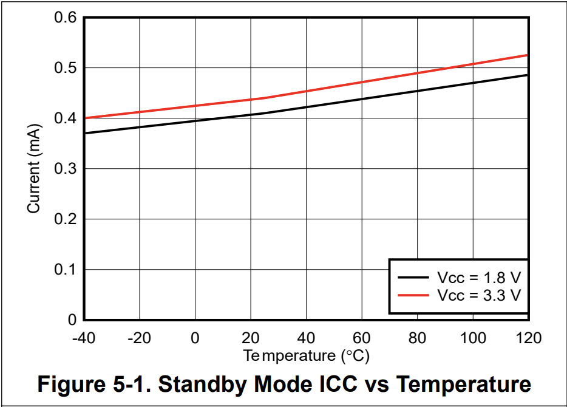
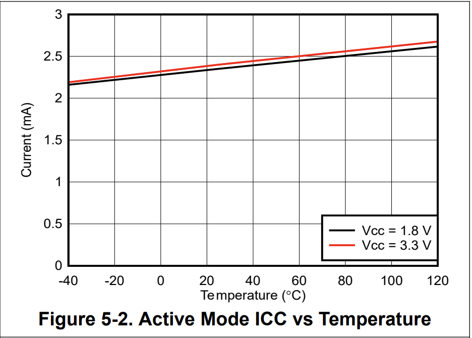
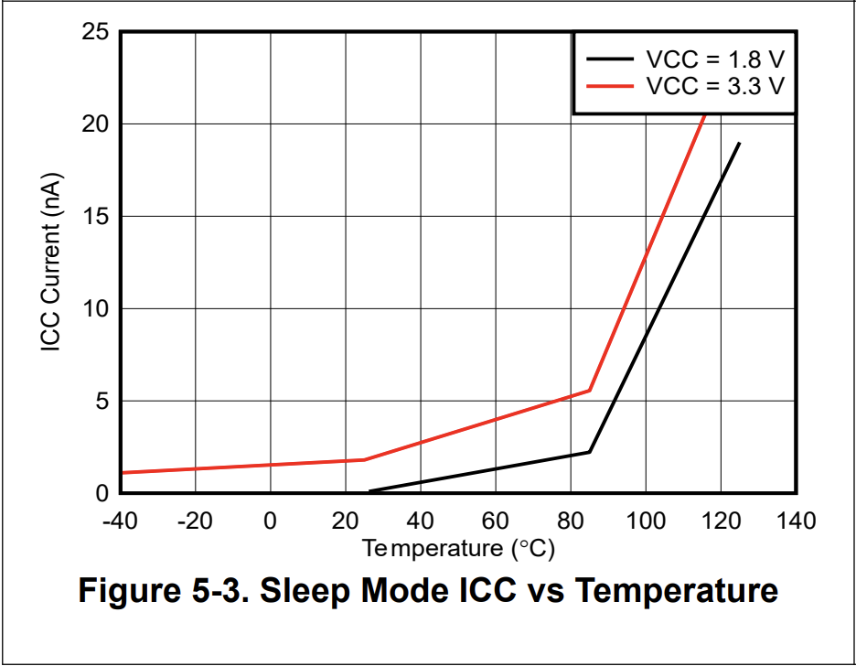
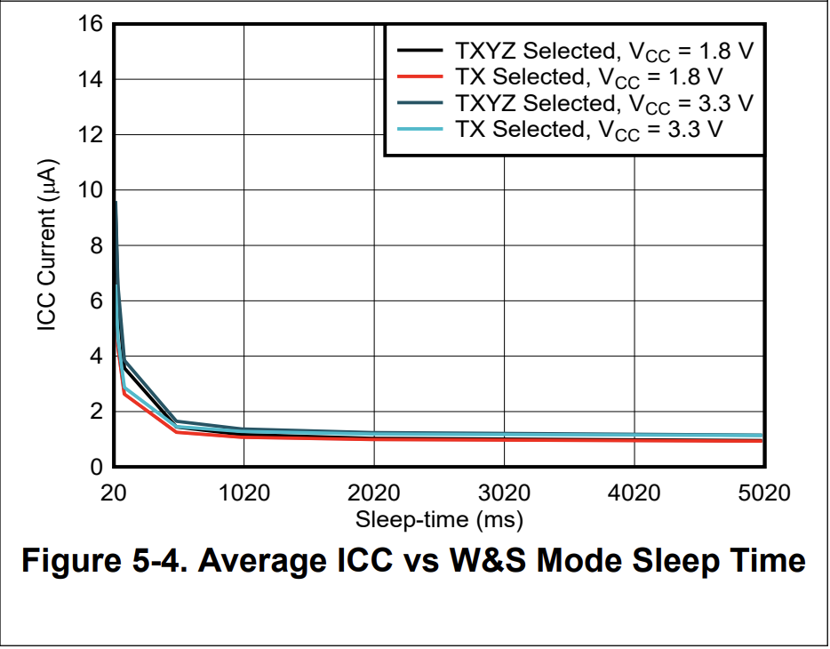

---

## 6 Detailed Description

### 6.1 Overview

The TMAG5273 IC is based on the Hall-effect technology and precision mixed signal circuitry from Texas Instruments. The output signals (raw X, Y, Z magnetic data and temperature data) are accessible through the I²C interface.

The IC consists of the following functional and building blocks:

- The Power Management & Oscillator block contains a low-power oscillator, biasing circuitry, undervoltage detection circuitry, and a fast oscillator.
- The sensing and temperature measurement block contains the Hall biasing, Hall sensors with multiplexers, noise filters, integrator circuit, temperature sensor, and the ADC. The Hall-effect sensor data and temperature data are multiplexed through the same ADC.
- The Interface block contains the I²C control circuitry, ESD protection circuits, and all the I/O circuits. The TMAG5273 supports multiple I²C read frames along with integrated cyclic redundancy check (CRC).

### 6.2 Functional Block Diagram

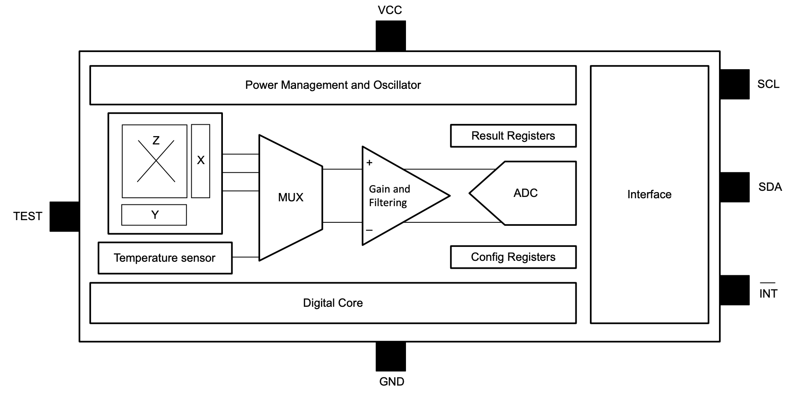

### 6.3 Feature Description

#### 6.3.1 Magnetic Flux Direction

The TMAG5273 generates positive ADC codes in response to a magnetic north pole in proximity. Similarly, the TMAG5273 generates negative ADC codes if the magnetic south poles approach from the same directions.

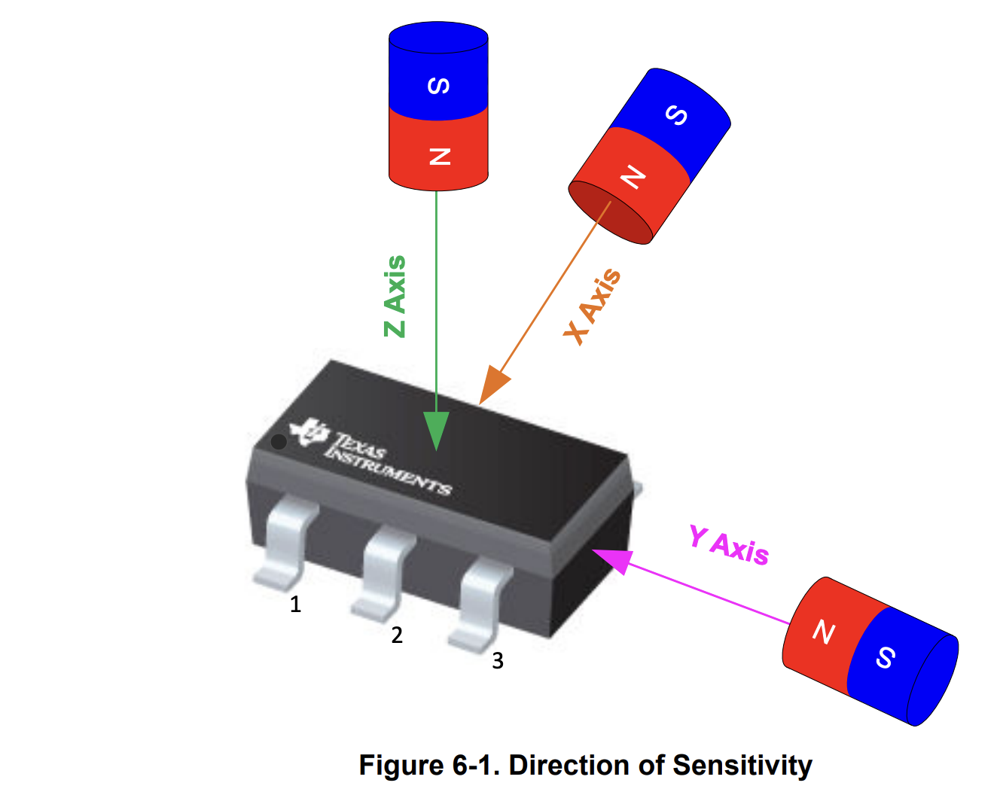

#### 6.3.2 Sensor Location

The X, Y, Z hall elements are located inside the TMAG5273 at the following offsets from pin 1: 1.85mm (along package length), 0.68mm (along package width), and 0.73mm (height from bottom of package).

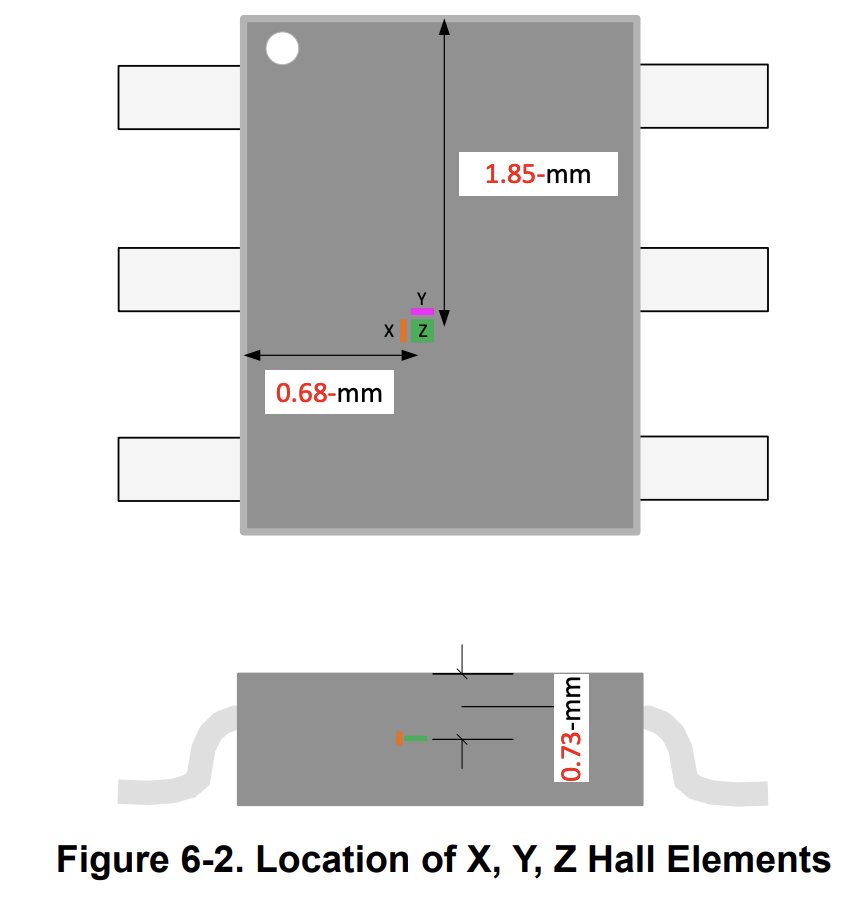

#### 6.3.3 Interrupt Function

The TMAG5273 supports flexible and configurable interrupt functions through either the INT̅ or the SCL pin. Table 6-1 shows different conversion completion events where result registers and SET_COUNT bits update,
and where they do not.

**Table 6-1. Result Register & SET_COUNT Update After Conversion Completion**

| INT_MODE | MODE DESCRIPTION                           | I²C BUS BUSY, NOT TALKING TO DEVICE | I²C BUS BUSY, NOT TALKING TO DEVICE | I²C BUS BUSY & TALKING TO DEVICE | I²C BUS BUSY & TALKING TO DEVICE | I²C BUS NOT BUSY | I²C BUS NOT BUSY  |
| -------- | ------------------------------------------ | ----------------------------------- | ----------------------------------- | -------------------------------- | -------------------------------- | ---------------- | ----------------- |
|          |                                            | RESULT UPDATE?                      | SET_COUNT UPDATE?                   | RESULT UPDATE?                   | SET_COUNT UPDATE?                | RESULT UPDATE?   | SET_COUNT UPDATE? |
| 000b     | No interrupt                               | Yes                                 | Yes                                 | No                               | No                               | Yes              | Yes               |
| 001b     | Interrupt through INT̅                      | Yes                                 | Yes                                 | No                               | No                               | Yes              | Yes               |
| 010b     | Interrupt through INT̅ except when I²C busy | Yes                                 | Yes                                 | No                               | No                               | Yes              | Yes               |
| 011b     | Interrupt through SCL                      | Yes                                 | Yes                                 | No                               | No                               | Yes              | Yes               |
| 100b     | Interrupt through SCL except when I²C busy | No                                  | No                                  | No                               | No                               | Yes              | Yes               |

> **Note:** TI does not recommend sharing the same I²C bus with multiple secondary devices when using the SCL pin for interrupt function. The SCL interrupt may corrupt transactions with other secondary devices if present in the same I²C bus.

**Interrupt Through SCL**

Figure 6-3 shows an example for interrupt function through the SCL pin with the device programmed to wake
up and sleep mode for threshold cross at a predefined intervals. The wake-up intervals can be set through the
SLEEPTIME bits. When the device detects a magnetic threshold cross, the TMAG5273 asserts a fixed width
interrupt signal through the SCL pin, and goes back to standby mode.

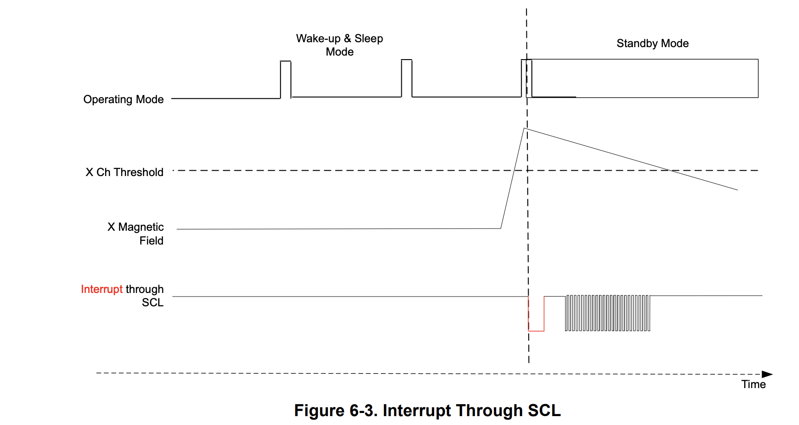

**Fixed Width Interrupt Through INT**

Figure 6-4 shows an example for fixed-width interrupt function through the INT pin. The device is programmed to
be in wake-up and sleep mode to detect a magnetic threshold. The INT_STATE register bit is set 1b. When the
device detects a magnetic threshold cross, the TMAG5273 asserts a fixed width interrupt signal through the INT
pin, and goes back to standby mode.

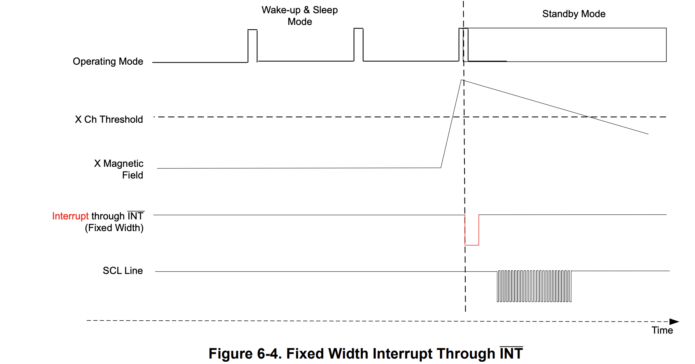

**Latched Interrupt Through INT**

Figure 6-5 shows an example for latched interrupt function through the INT pin. The device is programmed to
be in wake-up and sleep mode to detect a magnetic threshold. The INT_STATE register bit is set 0b. When the
device detects a magnetic threshold cross, the TMAG5273 asserts a latched interrupt signal through the INT pin and goes back to standby mode. The interrupt latch is cleared only after the device receives a valid address
through the SCL line.

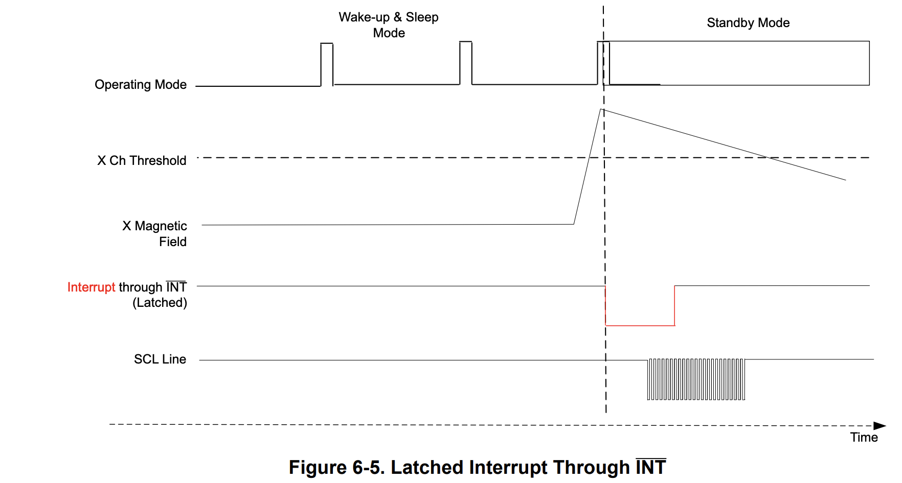

#### 6.3.4 Device I²C Address

Table 6-2 shows the default factory programmed I2C addresses of the TMAG5273. The device needs to be
addressed with the factory default I2C address after power up. If required, a primary can assign a new I2C
address through the I2C_ADDRESS register bits after power up.

**Table 6-2. I²C Default Address**

| DEVICE VERSION | MAGNETIC RANGE   | I²C ADDRESS (7 MSB BITS) | I²C WRITE ADDRESS (8-BIT) | I²C READ ADDRESS (8-BIT) |
| -------------- | ---------------- | ------------------------ | ------------------------- | ------------------------ |
| TMAG5273A1     | ±40 mT, ±80 mT   | 35h                      | 6Ah                       | 6Bh                      |
| TMAG5273B1     | ±40 mT, ±80 mT   | 22h                      | 44h                       | 45h                      |
| TMAG5273C1     | ±40 mT, ±80 mT   | 78h                      | F0h                       | F1h                      |
| TMAG5273D1     | ±40 mT, ±80 mT   | 44h                      | 88h                       | 89h                      |
| TMAG5273A2     | ±133 mT, ±266 mT | 35h                      | 6Ah                       | 6Bh                      |
| TMAG5273B2     | ±133 mT, ±266 mT | 22h                      | 44h                       | 45h                      |
| TMAG5273C2     | ±133 mT, ±266 mT | 78h                      | F0h                       | F1h                      |
| TMAG5273D2     | ±133 mT, ±266 mT | 44h                      | 88h                       | 89h                      |

#### 6.3.5 Magnetic Range Selection

Table 6-3 shows the magnetic range selection for the TMAG5273 device. The X, Y, and Z axes range can be
selected with the X_Y_RANGE and Z_RANGE register bits.

**Table 6-3. Magnetic Range Selection**

|                 | RANGE REGISTER SETTING | TMAG5273A1 | TMAG5273A2 | COMMENT                |
| --------------- | ---------------------- | ---------- | ---------- | ---------------------- |
| X, Y Axis Field | X_Y_RANGE = 0b         | ±40-mT     | ±133-mT    |                        |
| X, Y Axis Field | X_Y_RANGE = 1b         | ±80-mT     | ±266-mT    | Better SNR performance |
| Z Axis Field    | Z_RANGE = 0b           | ±40-mT     | ±133-mT    |                        |
| Z Axis Field    | Z_RANGE = 1b           | ±80-mT     | ±266-mT    | Better SNR performance |

#### 6.3.6 Update Rate Settings

The TMAG5273 offers multiple update rates to offer design flexibility to system designers. The different update
rates can be selected with the CONV_AVG register bits. Table 6-4 shows different update rate settings for the
TMAG5273.

**Table 6-4. Update Rate Settings**

| OPERATING MODE | REGISTER SETTING | UPDATE RATE SINGLE AXIS | UPDATE RATE TWO AXES | UPDATE RATE THREE AXES | COMMENT             |
| -------------- | ---------------- | ----------------------- | -------------------- | ---------------------- | ------------------- |
| X, Y, Z Axis   | CONV_AVG = 000b  | 20.0-kSPS               | 13.3-kSPS            | 10.0-kSPS              | Fastest update rate |
| X, Y, Z Axis   | CONV_AVG = 001b  | 13.3-kSPS               | 8.0-kSPS             | 5.7-kSPS               |                     |
| X, Y, Z Axis   | CONV_AVG = 010b  | 8.0-kSPS                | 4.4-kSPS             | 3.1-kSPS               |                     |
| X, Y, Z Axis   | CONV_AVG = 011b  | 4.4-kSPS                | 2.4-kSPS             | 1.6-kSPS               |                     |
| X, Y, Z Axis   | CONV_AVG = 100b  | 2.4-kSPS                | 1.2-kSPS             | 0.8-kSPS               |                     |
| X, Y, Z Axis   | CONV_AVG = 101b  | 1.2-kSPS                | 0.6-kSPS             | 0.4-kSPS               | Best SNR case       |

### 6.4 Device Functional Modes

The TMAG5273 supports multiple functional modes for a wide array of applications. A specific functional mode is selected by setting the corresponding value in the OPERATING_MODE register bits. The device starts powering up after VCC supply crosses the minimum threshold as specified in the Recommended Operating Condition (ROC) table.

#### 6.4.1 Standby (Trigger) Mode

The TMAG5273 goes to standby mode after first time powering up. At this mode the digital circuitry and oscillators are on, and the device is ready to accept commands from the primary device. Based off the commands the device can start a sensor data conversion, go to power saving mode, or start data transfer through I²C interface. A new conversion can be triggered through I²C command or through INT̅ pin. In this mode the device retains the immediate past conversion result data in the corresponding result registers. The time for the device to go from power up to standby mode is listed as T_start_power_up in the Power up & Conversion Time table.

#### 6.4.2 Sleep Mode

The TMAG5273 supports an ultra-low power sleep mode where the device retains the critical user configuration settings. The device does not retain the conversion result data in sleep mode. A primary can wake up the device from sleep mode through I²C interface or the INT̅ pin. During the transition from sleep mode to standby mode through I²C interface the INT̅ pin briefly asserts an interrupt. The INT̅ pin recovers after the device fully transitions to the standby mode with RESULT_STATUS bit set to 0h indicating no conversion is completed. The time it takes for the device to go to standby mode from sleep mode is denoted by T_start_sleep.

#### 6.4.3 Wake-up and Sleep (W&S) Mode

In this mode the TMAG5273 can be configured to go to sleep and wake up at a certain interval, and measure sensor data based off the SLEEPTIME register bits setting. The device can be set to generate an interrupt through the INT_CONFIG_1 register. After the conversion is complete and the interrupt condition is met, the TMAG5273 exits the W&S mode and goes into standby mode. The last measured data is stored in the corresponding result registers before the device goes to the standby mode. If the interrupt condition is not met, the device continues in W&S mode to wake up and measure data at the specified interval. A primary can wake up the TMAG5273 anytime during the W&S mode through I²C bus or INT̅ pin. The result interrupt function is not available during the W&S mode. The time for the device to go from W&S mode to standby mode is listed as T_start_sleep in the Power up & Conversion Time table.

#### 6.4.4 Continuous Measure Mode

In this mode the TMAG5273 continuously measures the sensor data per SENSOR_CONFIG & DEVICE_CONFIG register settings. In this mode the result registers can be accessed through the I²C lines. The time for the device to go from continuous measure mode to standby mode is listed as T_start_measure in the Power up & Conversion Time table.

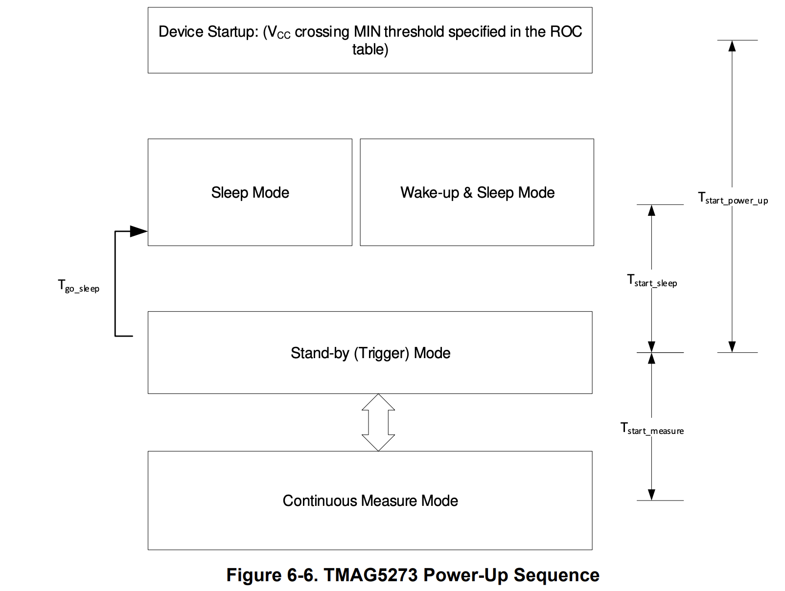

Table 6-5 shows different device operational modes of the TMAG5273.

**Table 6-5. Operating Modes**

| OPERATING MODE          | DEVICE FUNCTION                                                                     | ACCESS TO USER REGISTERS | RETAIN USER CONFIGURATION | COMMENT                                                                                                                  |
| ----------------------- | ----------------------------------------------------------------------------------- | ------------------------ | ------------------------- | ------------------------------------------------------------------------------------------------------------------------ |
| Continuous Measure Mode | Continuously measuring x, y, z axis, or temperature data                            | Yes                      | Yes                       |                                                                                                                          |
| Standby Mode            | Device is ready to accept I²C commands and start active conversion                  | Yes                      | Yes                       |                                                                                                                          |
| Wake-up and Sleep Mode  | Wakes up at a certain interval to measure the x, y, z axis, or temperature data     | No                       | Yes                       | 1ms, 5ms, 10ms, 15ms, 20ms, 30ms, 50ms, 100ms, 500ms, 1000ms, 2000ms, 5000ms, and 20000ms intervals supported.           |
| Sleep Mode              | Device retains key configuration settings, but does not retain the measurement data | No                       | Yes                       | The primary device can use sleep mode to implement other power saving intervals not supported by wake-up and sleep mode. |

### 6.5 Programming

#### 6.5.1 I²C Interface

The TMAG5273 offers I²C interface, a two-wire interface to connect low-speed devices like microcontrollers, A/D and D/A converters, I/O interfaces and other similar peripherals in embedded systems.

##### 6.5.1.1 SCL

The SCL is the clock line used to synchronize all data transfers over the I²C bus.

##### 6.5.1.2 SDA

SDA is the bidirectional data line for the I²C interface.

##### 6.5.1.3 I²C Read/Write

The TMAG5273 supports multiple I²C read and write frames targeting different applications. I2C_RD and CRC_EN bits offers multiple read frames to optimize the read time, data resolution and data integrity for a select application.

###### 6.5.1.3.1 Standard I²C Write

Figure 6-7 shows an example of standard I2C two byte write command supported by TMAG5273. The starting
byte contains 7-bit secondary device address and a 0 at the R/W command bit. The MSB of the second byte
contains the conversion trigger bit. Write 1 at this trigger bit to start a new conversion after the register address
decoding is complete. The seven LSB bits of the second byte contains the starting register address for the
write command. After the two command bytes, the primary device starts to send the data to be written at the
corresponding register address. Each successive write byte sends the data for the successive register address
in the secondary device.

###### 6.5.1.3.2 General Call Write

Figure 6-8 shows an example of the general call I2C write command supported by the TMAG5273. This
command is useful to configure multiple I2C devices in a I2C bus simultaneously. The starting byte contains
8-bit 0s. The MSB of the second byte contains the conversion trigger bit. Write 1 at this trigger bit to start a new
conversion after the register address decoding is completed. The seven LSB bits of the second byte contains the
starting register address for the write command. After the two command bytes, the primary device starts to send
the data to be written at the corresponding register address of all the secondary devices in the I2C bus. Each
successive write byte sends the data for the successive register address in the secondary devices.

###### 6.5.1.3.3 Standard 3-Byte I²C Read

Figure 6-9 and Figure 6-10 show examples of standard I2C three byte read command supported by the
TMAG5273. The starting byte contains 7-bit secondary device address and the R/W command bit 0. The
MSB of the second byte contains the conversion trigger command bit. Write 1 at this trigger bit to start a
new conversion after the register address decoding is completed. The seven LSB bits of the second byte
contains the starting register address for the write command. After receiving ACK signal from secondary, the
primary send the secondary address once again with R/W command bit as 1. The secondary starts to send the
corresponding register data, and sends successive register data with each successive ACK from the primary. If
CRC is enabled, the secondary sends the fifth CRC byte based off the CRC calculation of immediate past four
register bytes.

###### 6.5.1.3.4 1-Byte I²C Read Command for 16-Bit Data

Figure 6-11 and Figure 6-12 show examples of 1-byte I2C read command supported by the TMAG5273. Select
I2C_RD =01b to enable this mode. The command byte contains 7-bit secondary device address and a 1 at the
R/W bit. In this mode, per MAG_CH_EN and T_CH_EN bits setting, the device sends 16-bit data of the enabled
channels and the CONV_STATUS register data byte. If CRC is enabled, the device sends an additional CRC
byte based off the CRC calculation of the command byte and the data sent in the current packet. When multiple
channels are enabled, the sent data follows the T, X, Y, and Z sequence in the successive data bytes.

###### 6.5.1.3.5 1-Byte I²C Read Command for 8-Bit Data

Figure 6-13 and Figure 6-14 show examples of 1-byte I2C read command supported by the TMAG5273. Select
I2C_RD =10b to enable this mode. The command byte contains 7-bit secondary device address and a 1 at the
R/W bit. In this mode, per MAG_CH_EN and T_CH_EN bits setting, the device sends 8-bit data of the enabled
channels and the CONV_STATUS register data byte. If CRC is enabled, the device sends an additional CRC
byte based off the CRC calculation of the command byte and the data sent in the current packet. When multiple
channels are enabled, the sent data follows the T, X, Y, and Z sequence in the successive data bytes.

###### 6.5.1.3.6 I²C Read CRC

The TMAG5273 supports optional CRC during I²C read. The CRC can be enabled through the CRC_EN register bit. The CRC is performed on a data string that is determined by the I²C read type. The CRC information is sent as a single byte after the data bytes. The code is generated by the polynomial x⁸ + x² + x + 1. Initial CRC bits are FFh.

The following equations can be employed to calculate CRC:

```
d = Data Input, c = Initial CRC (FFh)
newcrc[0] = d[7] ^ d[6] ^ d[0] ^ c[0] ^ c[6] ^ c[7]
newcrc[1] = d[6] ^ d[1] ^ d[0] ^ c[0] ^ c[1] ^ c[6]
newcrc[2] = d[6] ^ d[2] ^ d[1] ^ d[0] ^ c[0] ^ c[1] ^ c[2] ^ c[6]
newcrc[3] = d[7] ^ d[3] ^ d[2] ^ d[1] ^ c[1] ^ c[2] ^ c[3] ^ c[7]
newcrc[4] = d[4] ^ d[3] ^ d[2] ^ c[2] ^ c[3] ^ c[4]
newcrc[5] = d[5] ^ d[4] ^ d[3] ^ c[3] ^ c[4] ^ c[5]
newcrc[6] = d[6] ^ d[5] ^ d[4] ^ c[4] ^ c[5] ^ c[6]
newcrc[7] = d[7] ^ d[6] ^ d[5] ^ c[5] ^ c[6] ^ c[7]
```

The following examples show calculated CRC byte based off various input datav:

- I²C Data 00h : CRC = F3h
- I²C Data FFh : CRC = 00h
- I²C Data 80h : CRC = 7Ah
- I²C Data 4Ch : CRC = 10h
- I²C Data E0h : CRC = 5Dh
- I²C Data 00000000h : CRC = D1h
- I²C Data FFFFFFFFh : CRC = 0Fh

#### 6.5.2 Data Definition

##### 6.5.2.1 Magnetic Sensor Data

data are stored in x_MSB_RESULT and x_LSB_RESULT registers. Figure 6-15 shows that each sensor output stored in a 16-bit 2's complement format in two 8-bit registers. The data can be retrieved as 16-bit format combining both MSB and LSB registers, or as 8-bit format through the MSB register.

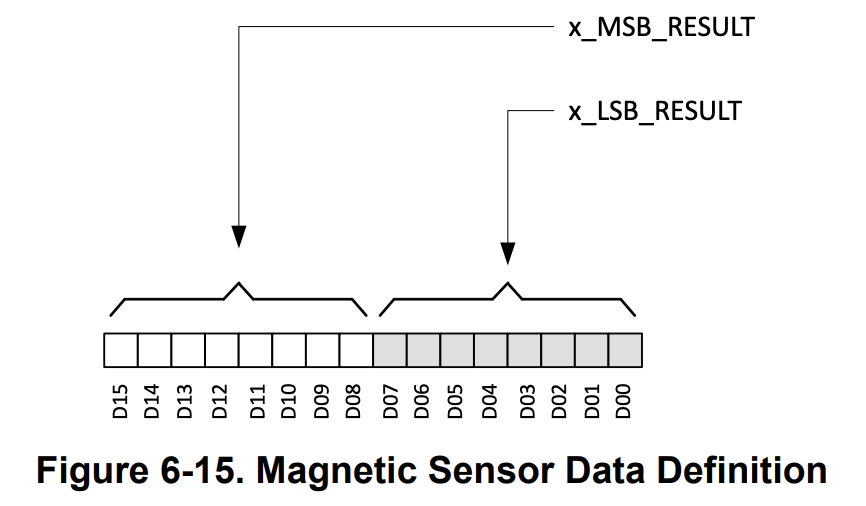

The measured magnetic field can be calculated using Equation 10 for 16-bit data:

$$B = \frac{-(D_{15} \times 2^{15}) + \sum_{i=0}^{14} D_i \times 2^i}{2^{16}} \times 2|B_R|  \qquad (10)$$

where:

- B is magnetic field in mT.
- D_i is the data bit.
- B_R is the magnetic range in mT for the corresponding channel.

And using Equation 11 for 8-bit data:

$$B = \frac{-(D_{15} \times 2^{7}) + \sum_{i=0}^{6} D_{i+8} \times 2^{i}}{2^{8}} \times 2|B_R|  \qquad (11)$$

##### 6.5.2.2 Temperature Sensor Data

The TMAG5273 will measure temperature from –40 °C to 170 °C. The temperature sensor data are stored in T_MSB_RESULT and T_LSB_RESULT registers. Figure 6-16 shows the sensor output stored in a 16-bit 2's complement format in two 8-bit registers. The data can be retrieved as 16-bit format combining both MSB and LSB registers, or as 8-bit format through the MSB register

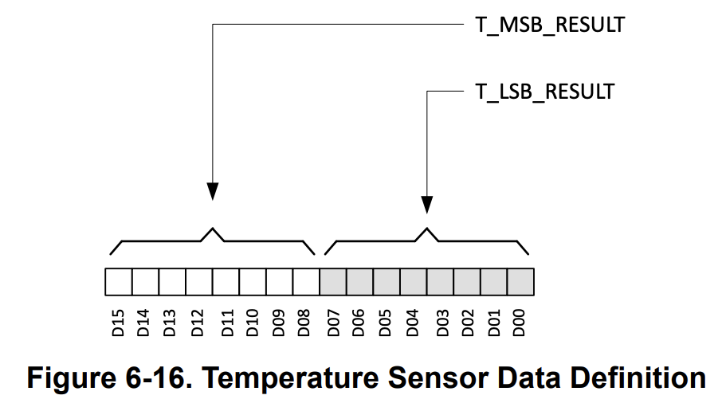

The measured temperature in degree Celsius can be calculated using Equation 12 for 16-bit data:

$$T = T_{SENS\_T0} + \frac{T_{ADC\_T} - T_{ADC\_T0}}{T_{ADC\_RES}}  \qquad (12)$$

where:

- T is the measured temperature in degree Celsius.
- T_SENS_T0 as listed in the Electrical Characteristics table.
- T_ADC_RES is the change in ADC code per degree Celsius.
- T_ADC_T0 as listed in the Electrical Characteristics table.
- T_ADC_T is the measured ADC code for temperature T.

And using Equation 13 for 8-bit data:

$$T = T_{SENS\_T0} + \frac{256 \times \left(T_{ADC\_T} - \frac{T_{ADC\_T0}}{256}\right)}{T_{ADC\_RES}}  \qquad (13)$$

##### 6.5.2.3 Angle and Magnitude Data Definition

The TMAG5273 calculates the angle from a pair of magnetic axes based off the ANGLE_EN register bits setting. Bits D04-D12 store angle integer value from 0 to 360 degree. Bits D00-D03 store fractional angle value. The 3-MSB bits are always populated as b000. The angle can be calculated using Equation 14:

$$A = \sum_{i=4}^{12} D_i \times 2^{i-4} + \frac{\sum_{i=0}^{3} D_i \times 2^{i}}{16}  \qquad (14)$$

where:

- A is the angle measured in degree.
- D_i is the data bit.

For example: a 354.50 degree is populated as `0001 0110 0010 1000b` and a 17.25 degree is populated as `000 0001 0001 0100b`.

During the angle calculation, use Equation 15 to calculate the resultant vector magnitude:

$$M = \sqrt{MADC_{Ch1}^{2} + MADC_{Ch2}^{2}}  \qquad (15)$$

where:

- MADC_Ch1, MADC_Ch2 are the ADC codes of the two magnetic channels selected for the angle calculation.

For on-axis angular measurement the magnitude value should remain constant across the full 360° measurement.

##### 6.5.2.4 Magnetic Sensor Offset Correction

The TMAG5273 enables offset correction for a pair of magnetic axes. The MAG_OFFSET_CONFIG_1 and MAG_OFFSET_CONFIG_2 registers store the offset values to be corrected in 2's complement data format. As an example, if the uncorrected waveform for a particular axis has a value that is +2mT too high, enter an offset correction value of –2mT in the corresponding offset correction register. The selection and order of the sensors are defined in the ANGLE_EN register bits setting. The default value of these offset correction registers are set as zero.

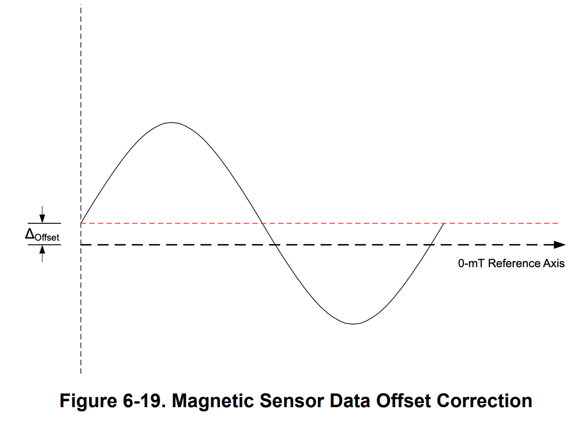

The amount of offset for each axis can be calculated using Equation 16. As an example, with a ±40mT range, MAG_OFFSET_CONFIG_1 set at 1000 0000b, and MAG_OFFSET_CONFIG_2 set at 0001 0000b, the offset correction for the first axis is −2.5mT and second axis is 0.312mT:

$$\Delta_{Offset} = \frac{-(D_7 \times 2^{7}) + \sum_{i=0}^{6} D_i \times 2^{i}}{2^{12}} \times 2|B_R|  \qquad (16)$$

where:

- Δ_Offset is the amount of offset correction to be applied in mT.
- D_i is the data bit in the MAG_OFFSET_CONFIG_1 or MAG_OFFSET_CONFIG_2 register.
- B_R is the magnetic range in mT for the corresponding channel.

As an example, with a ±40mT range, MAG_OFFSET_CONFIG_1 set at `1000 0000b`, and MAG_OFFSET_CONFIG_2 set at `0001 0000b`, the offset correction for the first axis is −2.5mT and second axis is 0.312mT.

Alternately values for MAG_OFFSET_CONFIG_1 or MAG_OFFSET_CONFIG_2 can be calculated for a target offset correction using Equation 17:

$$MAG\_OFFSET = \frac{2^{12} \times \Delta_{Offset}}{2|B_R|}  \qquad (17)$$

where:

- MAG_OFFSET is the decimal value to be entered in the MAG_OFFSET_CONFIG_1 or MAG_OFFSET_CONFIG_2 register.
- Δ_Offset is the amount of offset correction to be applied in mT.
- B_R is the magnetic range in mT for the corresponding channel.

---

## 7 Application and Implementation

> **Note:** Information in the following applications sections is not part of the TI component specification, and TI does not warrant its accuracy or completeness. TI's customers are responsible for determining suitability of components for their purposes, as well as validating and testing their design implementation to confirm system functionality.

### 7.1 Application Information

#### 7.1.1 Select the Sensitivity Option

Select the highest TMAG5273 sensitivity option that can measure the required range of magnetic flux density so that the ADC input range is maximized.

Larger-sized magnets and farther sensing distances can generally enable better positional accuracy than very small magnets at close distances, because magnetic flux density increases exponentially with the proximity to a magnet.

#### 7.1.2 Temperature Compensation for Magnets

The TMAG5273 temperature compensation is designed to directly compensate the average temperature drift of several magnets as specified in the MAG_TEMPCO register bits. The residual induction (Br) of a magnet typically reduces by 0.12%/°C for NdFeB, and 0.20%/°C for ferrite magnets as the temperature increases. Set the MAG_TEMPCO bit to default 00b if the device temperature compensation is not needed.

#### 7.1.3 Sensor Conversion

Multiple conversion schemes can be adopted based off the MAG_CH_EN and CONV_AVG register bits settings.

##### 7.1.3.1 Continuous Conversion

The TMAG5273 can be set in continuous conversion mode when OPERATING_MODE is set to 10b. Figure 7-1 shows few examples of continuous conversion. The input magnetic field is processed in two steps. In the first step the device spins the hall sensor elements, and integrates the sampled data. In the second step the ADC block converts the analog signal into digital bits and stores in the corresponding result register. While the ADC starts processing the first magnetic sample, the spin block can start processing another magnetic sample. In this mode the temperature data is taken at the beginning of each new conversion. This temperature data is used to compensate for the magnetic thermal drift.

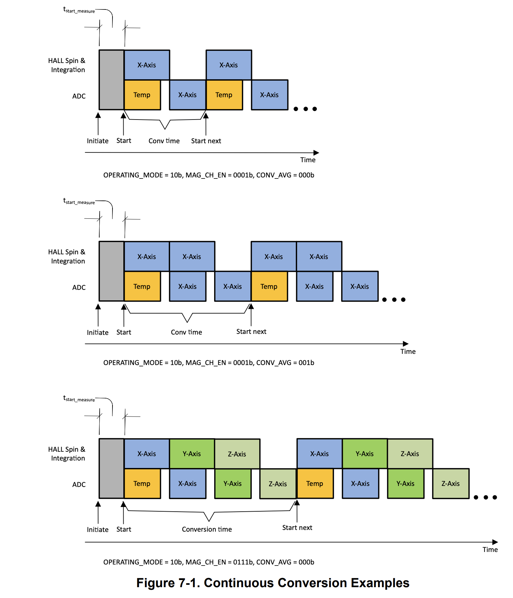

##### 7.1.3.2 Trigger Conversion

The TMAG5273 supports trigger conversion with OPERATING_MODE set to 00b. The trigger event can be initiated through I2C command or INT signal. Figure 7-2 shows an example of trigger conversion with temperature, X, Y, and Z sensors activated.

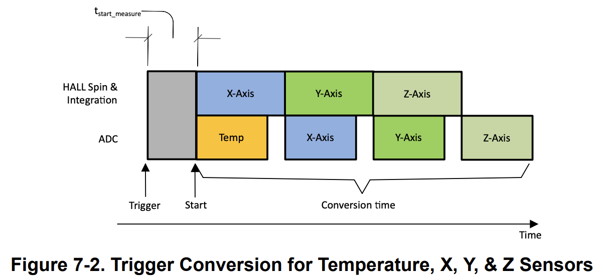

##### 7.1.3.3 Pseudo-Simultaneous Sampling

In absolute angle measurement, application sensor data from multiple axes are required to calculate an accurate angle. The magnetic field data collected at different times through the same signal chain introduces error in angle calculation. The TMAG5273 offers pseudo-simultaneous sampling data collection modes to eliminate this error.

$$t_Z = \frac{t_{X1} + t_{X2}}{2}  \qquad (18)$$

where:

- t_X1, t_Z, t_X2 are time stamps for X, Z, X sensor data completion.

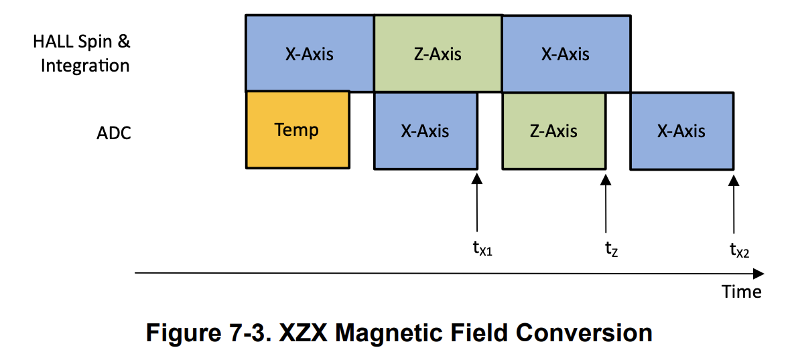

The vertical X, Y sensors of the TMAG5273 exhibit more noise than the horizontal Z sensor. The pseudo-simultaneous sampling can be used to equalize the noise floor when two sets of vertical sensor data are collected against one set of horizontal sensor data, as in examples of XZX or YZY modes.

#### 7.1.4 Magnetic Limit Check

The TMAG5273 enables magnetic limit checks for single or multiple axes at the same time. Figure 7-4 to Figure 7-7 show examples of magnetic limit cross detection events while the field going above, below, exiting a magnetic band, and entering a magnetic band. The device generates an interrupt with each new conversion if the magnetic fields remain in the shaded regions of the figures. The MAG_THR_DIR and THR_HYST register bits help select different limit cross modes.

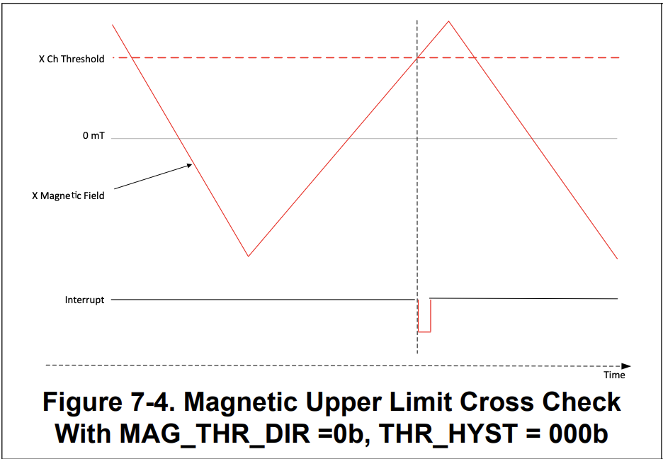

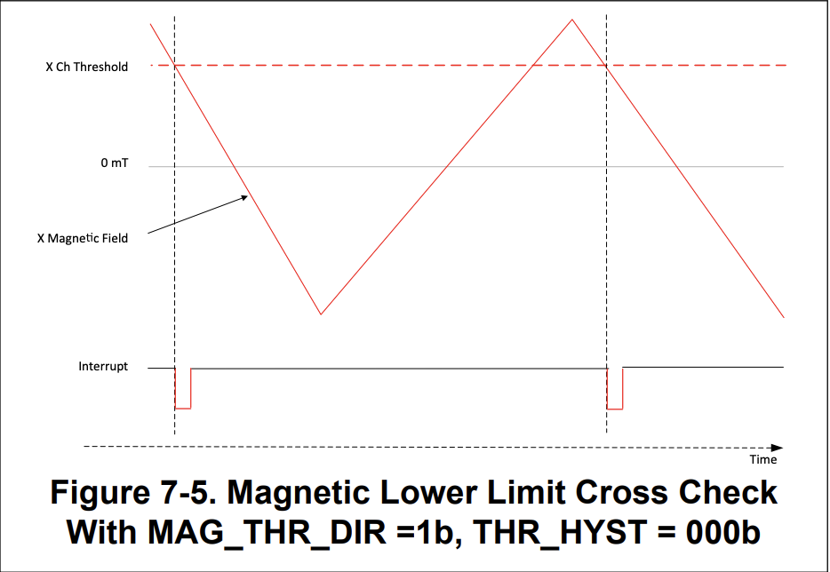

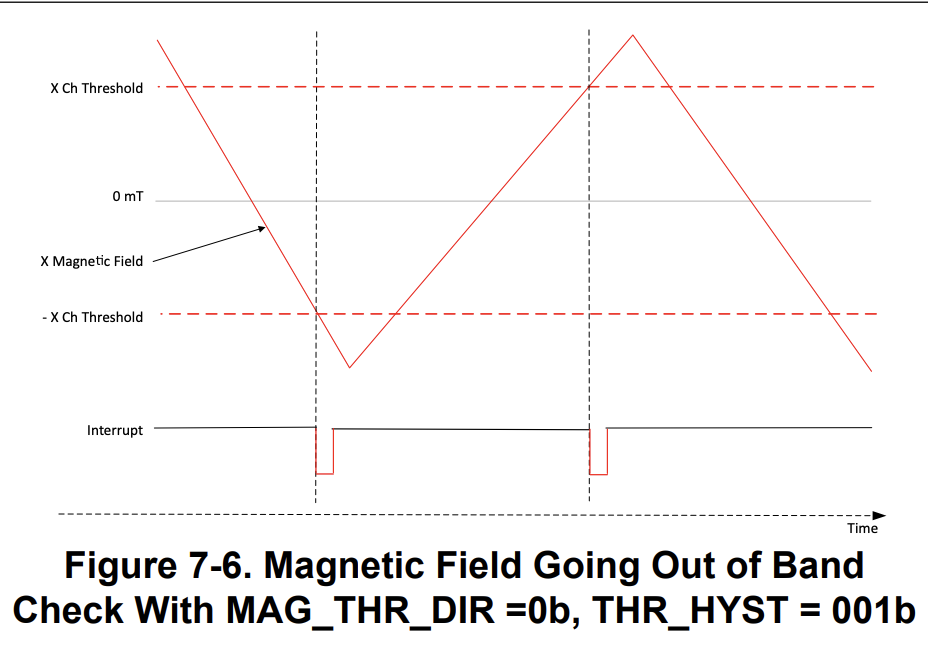

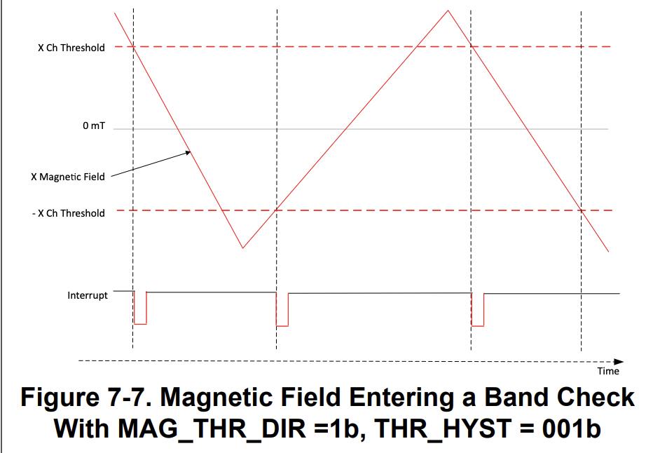

#### 7.1.5 Error Calculation During Linear Measurement

The TMAG5273 offers independent configurations to perform linear position measurements in X, Y, and Z axes. To calculate the expected error during linear measurement, the contributions from each of the individual error sources must be understood. The relevant error sources include sensitivity error, offset, noise, cross axis sensitivity, hysteresis, nonlinearity, drift across temperature, drift across life time, and so forth. For a 3-axis Hall sensor like the TMAG5273, the cross-axis sensitivity and hysteresis error sources are insignificant. Use Equation 19 to estimate the linear measurement error calculation at room temperature.

$$Error_{LM\_25C} = \frac{\sqrt{(B \times SENS_{ER})^2 + B_{off}^2 + N_{RMS\_25}^2}}{B} \times 100\%  \qquad (19)$$

where:

- Error_LM_25C is total error in % during linear measurement at 25°C.
- B is input magnetic field.
- SENS_ER is sensitivity error in decimal number at 25°C.
- B_off is offset error at 25°C.
- N_RMS_25 is RMS noise at 25°C.

In many applications, system level calibration at room temperature can nullify the offset and sensitivity errors at 25°C. The noise errors can be reduced by internally averaging by up to 32x on the device in addition to the averaging that can be done in the microcontroller. Use Equation 20 to estimate the linear measurement error across temperature after calibration at room temperature.

$$Error_{LM\_Temp} = \frac{\sqrt{(B \times SENS_{DR})^2 + B_{off\_DR}^2 + N_{RMS\_Temp}^2}}{B} \times 100\%  \qquad (20)$$

where:

- Error_LM_Temp is total error in % during linear measurement across temperature after room temperature calibration.
- B is input magnetic field.
- SENS_DR is sensitivity drift in decimal number from value at 25°C.
- B_off_DR is offset drift from value at 25°C.
- N_RMS_Temp is RMS noise across temperature.

If room temperature calibration is not performed:

$$Error_{LM\_Temp\_NCal} = \frac{\sqrt{(B \times SENS_{ER})^2 + (B \times SENS_{DR})^2 + B_{off}^2 + B_{off\_DR}^2 + N_{RMS\_Temp}^2}}{B} \times 100\%  \qquad (21)$$

where:

- ErrorLM_Temp_NCal is total error in % during linear measurement across temperature without room temperature
  calibration

> **Note:** Error sources such as system mechanical vibration, magnet temperature gradient, earth magnetic field, nonlinearity, lifetime drift, and so forth, are not considered. The user must take these additional error sources into account while calculating overall system error budgets.

#### 7.1.6 Error Calculation During Angular Measurement

The TMAG5273 offers on-chip CORDIC to measure angle data from any of the two magnetic axes. The linear magnetic axis data can be used to calculate the angle using an external CORDIC as well. To calculate the expected error during angular measurement, the contributions from each individual error source must be understood. The relevant error sources include sensitivity error, offset, noise, axis-axis mismatch, nonlinearity, drift across temperature, drift across life time, and so forth. Use the Angle Error Calculation Tool to estimate the total error during angular measurement.

### 7.2 Typical Application

Magnetic 3D sensors are very popular due to contactless and reliable measurements, especially in applications requiring long-term measurements in rugged environments. The TMAG5273 offers design flexibility in wide range of industrial and personal electronics applications. In this section three common application examples are discussed in details.

#### 7.2.1 Magnetic Tamper Detection

Given the susceptibility to magnetic tampering, electricity meters often include magnetic sensors designed to detect external magnetic fields and take appropriate actions, such as disconnecting services to the electricity meter or applying a penalty fee for tampering. Magnetic tampering can result from a permanent magnet in any of the three orientations. Another form of magnetic tampering can be generated through an external coil powered from AC supply mains. The TMAG5273 offers flexible operating modes and configuration of three independent Hall-sensors to detect tampering.

##### 7.2.1.1 Design Requirements

Use the parameters listed in Table 7-1 for this design example.

**Table 7-1. Design Parameters**

| Design Parameters                 | Operating on AC Supply                                                                                 | Operating on Back-Up Battery                             |
| --------------------------------- | ------------------------------------------------------------------------------------------------------ | -------------------------------------------------------- |
| Device                            | TMAG5273-A2                                                                                            | TMAG5273-A2                                              |
| VCC                               | 3.3V                                                                                                   | 3.6V to 1.7V                                             |
| Operating Mode                    | Continuous measure mode                                                                                | Wake-up and sleep mode                                   |
| Design Objective                  | Read the raw magnetic data and determine the magnitude and type of tampering (AC or DC magnetic field) | Wake up the microcontroller if magnetic tampering occurs |
| Timing Budget to Detect Tampering | <100ms                                                                                                 | <5s                                                      |
| Desired Battery Life              | N/A                                                                                                    | 5 Year                                                   |

##### 7.2.1.2 Detailed Design Procedure

Select a power multiplexer that allows powering the system from AC power line as default option. In case of power outage the power multiplexer automatically switches to back-up battery for powering the system. A status signal from, either the AC-DC regulator or the multiplexer, notifies the microcontroller on power outage events. The microcontroller, upon receiving the status signal, configures the TMAG5273 to operate in wake-up and sleep mode. The TMAG5273 wakes up and measures the magnetic field at a prespecified interval. The device repeats the cycle if no tampering happens. In case of tampering, the device can exit the wake-up and sleep mode and send an interrupt signal to the microcontroller.

Perform the following steps to set the device in continuous measure mode and minimize the number of steps required during battery back-up modes:

- Set the DEVICE_CONFIG_1 register to 1h.
- Set the SENSOR_CONFIG_1 register to 79h.
- Set the T_CONFIG register to 1h.
- Set the INT_CONFIG_1 register to A4h.
- Set the DEVICE_CONFIG_2 register to 22h.
- Wait for the INT signal assert low to indicate conversion complete. When INT goes low, perform the 16-bit T, X, Y, Z register read with one single read command.

During power outage event perform only the following steps to set the sensor in the wake-up and sleep mode:

- Set the INT_CONFIG_1 register to 64h.
- Set the DEVICE_CONFIG_2 register to 23h.
- If a threshold detection event occurs, the INT signal asserts low to wake-up the microcontroller. When INT goes low, perform the 16-bit T, X, Y, Z register read with one single read command.

##### 7.2.1.3 Application Curves

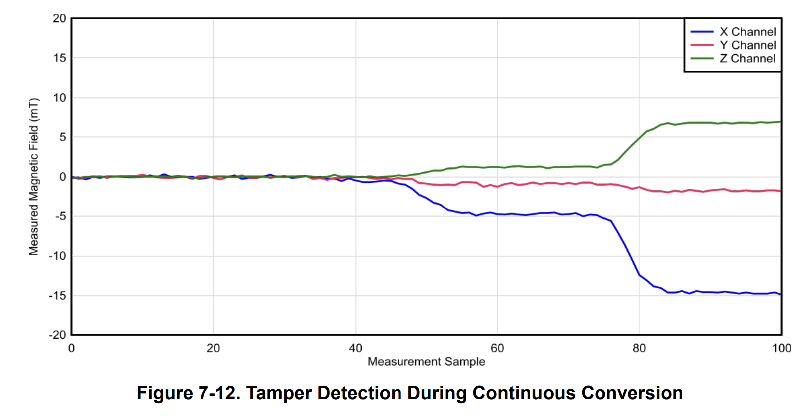

#### 7.2.2 I²C Address Expansion

The TMAG5273 is offered in four different factory-programmed I²C addresses. The device also supports additional I²C addresses through the configuration of the I2C_ADDRESS register. There are 7-bits to select 128 different addresses. Take system limitations like bus loading, maximum clock frequency, available GPIOs from a microcontroller, and so forth, in account before selecting maximum number of sensors in a single I²C bus.

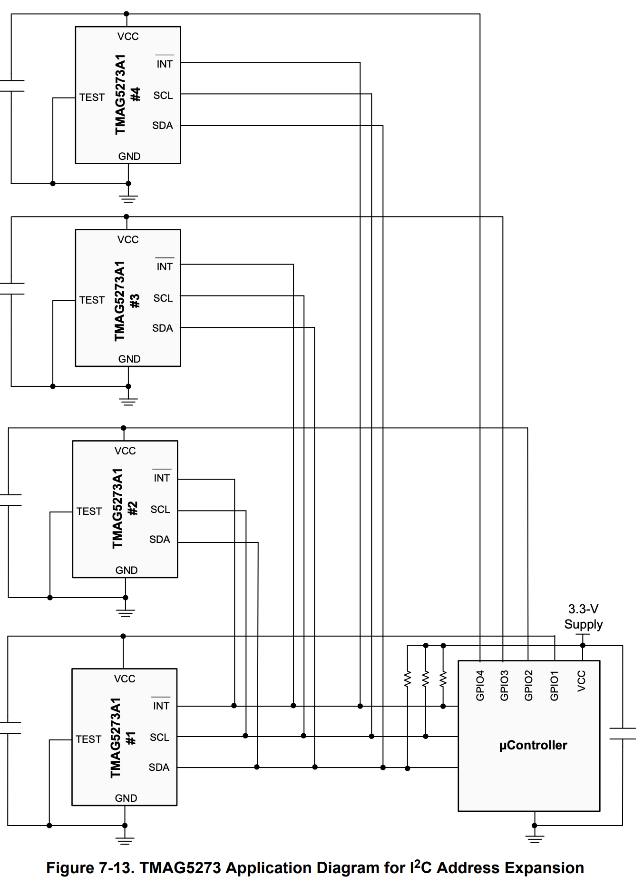

##### 7.2.2.1 Design Requirements

Use the parameters listed in Table 7-2 for this design example.

**Table 7-2. Design Parameters**

| Parameters                | Design Target                                                              |
| ------------------------- | -------------------------------------------------------------------------- |
| Device orderable          | TMAG5273A1                                                                 |
| VCC                       | 3.3V                                                                       |
| # of Devices in same bus  | 4 (same method can be used to expand the number of sensors in the I²C bus) |
| Design objective          | Optimize the # GPIO and component count                                    |
| Current supply per sensor | 5mA, supplied by a microcontroller GPIO                                    |

##### 7.2.2.2 Detailed Design Procedure

Select GPIO with current supply capability of 5mA. The SCL, SDA lines and INT pin can be shared. However, the function of the INT pin needs to be analyzed when shared by multiple sensors. As an example, if the sensors are configured to generate interrupt through the INT pin, the microcontroller needs to read all the sensors to determine which specific one sending the interrupt. Take the following steps sequentially to assign new I²C addresses to the four TMAG5273:

- Turn on the GPIO#1 and wait until t_start_power_up time is elapsed.
- Address the device#1 with factory programmed address. Write to the I2C_ADDRESS register to assign a new address.
- Turn on the GPIO#2 and wait until t_start_power_up time is elapsed.
- Address the device#2 with factory programmed address. Write to the I2C_ADDRESS register to assign a new unique address.
- Turn on the GPIO#3 and wait until t_start_power_up time is elapsed.
- Address the device#3 with factory programmed address. Write to the I2C_ADDRESS register to assign a new unique address.
- Turn on the GPIO#4 and wait until t_start_power_up time is elapsed.
- Address the device#4 with factory programmed address. Write to the I2C_ADDRESS register to assign a new unique address.

Repeat the above steps if there is a power outage or power-up reset condition.

#### 7.2.3 Angle Measurement

Magnetic angle sensors are very popular due to contactless and reliable measurements, especially in applications requiring long-term measurements in rugged environments. The TMAG5273 offers an on-chip angle calculator providing angular measurement based off any two of the magnetic axes. The two axes of interest can be selected in the ANGLE_EN register bits. The device offers angle output in complete 360 degree scale. Take several error sources into account for angle calculation, including sensitivity error, offset error, linearity error, noise, mechanical vibration, temperature drift, and so forth.

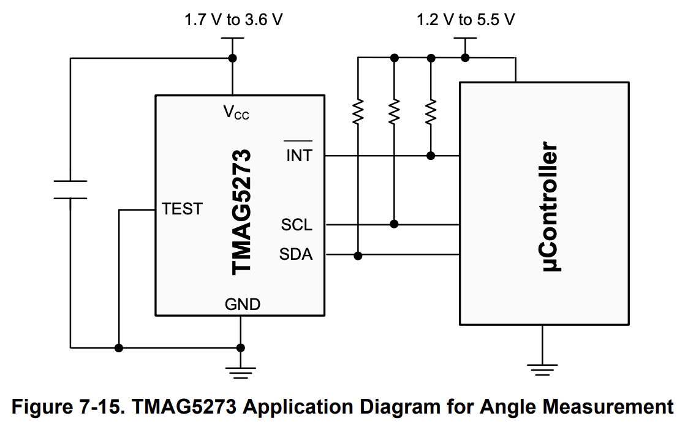

##### 7.2.3.1 Design Requirements

Use the parameters listed in Table 7-3 for this design example.

**Table 7-3. Design Parameters**

| Design Parameters        | On-Axis Measurement                                                                                  | Off-Axis Measurement                                                                                 |
| ------------------------ | ---------------------------------------------------------------------------------------------------- | ---------------------------------------------------------------------------------------------------- |
| Device                   | TMAG5273-A1                                                                                          | TMAG5273-A1                                                                                          |
| VCC                      | 3.3V                                                                                                 | 3.3V                                                                                                 |
| Device Position          | Directly under the magnet                                                                            | At the adjacent side of the magnet                                                                   |
| Magnet                   | Cylinder: 4.7625mm diameter, 12.7mm thick, neodymium N52, Br = 1480                                  | Cylinder: 4.7625mm diameter, 12.7mm thick, neodymium N52, Br = 1480                                  |
| Magnetic Range Selection | Select the same range for both axes based off the highest possible magnetic field seen by the sensor | Select the same range for both axes based off the highest possible magnetic field seen by the sensor |
| RPM                      | <600                                                                                                 | <600                                                                                                 |
| Desired Accuracy         | <2° for 360° rotation                                                                                | <2° for 360° rotation                                                                                |

##### 7.2.3.2 Detailed Design Procedure

For accurate angle measurement, the two axes amplitudes must be normalized by selecting the proper gain adjustment value in the MAG_GAIN_CONFIG register. The gain adjustment value is a fractional decimal number between 0 and 1. The following steps must be followed to calculate this fractional value:

- Set the device at 32x average mode and rotate the shaft full 360 degree.
- Record the two axes sensor ADC codes for the full 360 degree rotation.
- A normalized plot for the full 360 degree rotations are represented in the application curves.
- Measure the maximum peak-peak ADC code delta for each axis, A_X and A_Y.
- If A_X > A_Y, set the MAG_GAIN_CH register bit to 0b. Calculate the gain adjustment value for X axis: G_X = A_Y / A_X
- If A_X < A_Y, set the MAG_GAIN_CH register bit to 1b. Calculate the gain adjustment value for Y axis: G_Y = 1 / G_X
- The target binary gain setting at the GAIN_VALUE register bits are calculated from the equation: G_X or G_Y = GAIN_VALUE_decimal / 256.

**Example 1:** If A_X = A_Y = 60,000, the GAIN_VALUE register bits are set at default 0000 0000b.

**Example 2:** If A_X = 60,000, A_Y = 45,000, the G_X = 45,000/60,000 = 0.75. Set MAG_GAIN_CH to 0b and GAIN_VALUE to 1100 0000b.

**Example 3:** If A_X = 45,000, A_Y = 60,000, the G_X = (60,000/45,000) = 1.33. Since G_X > 1, the gain adjustment needs to be applied to Y axis with G_Y = 1/G_X. Set MAG_GAIN_CH to 1b and GAIN_VALUE to 1100 0000b.

###### 7.2.3.2.1 Gain Adjustment for Angle Measurement

Common measurement topology include angular position measurements in on-axis or off-axis angular measurements. Select the on-axis measurement topology whenever possible as this offers the best optimization of magnetic field and the device measurement ranges. The TMAG5273 offers on-chip gain adjustment option to account for mechanical position misalignments.

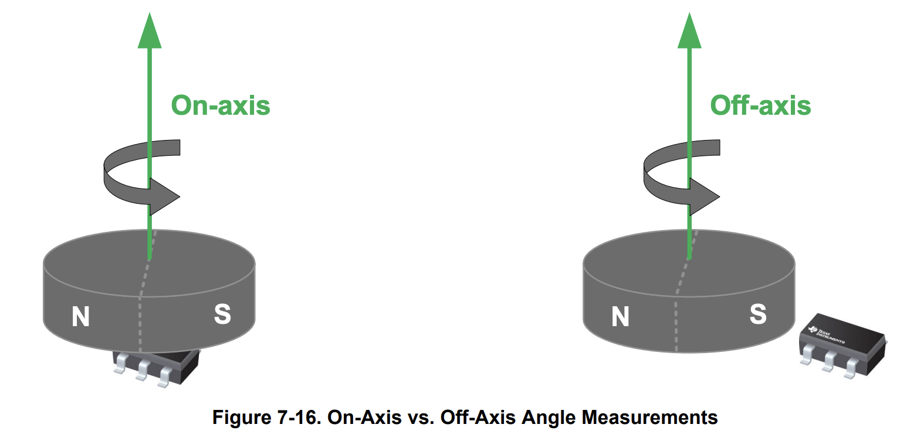

##### 7.2.3.3 Application Curves

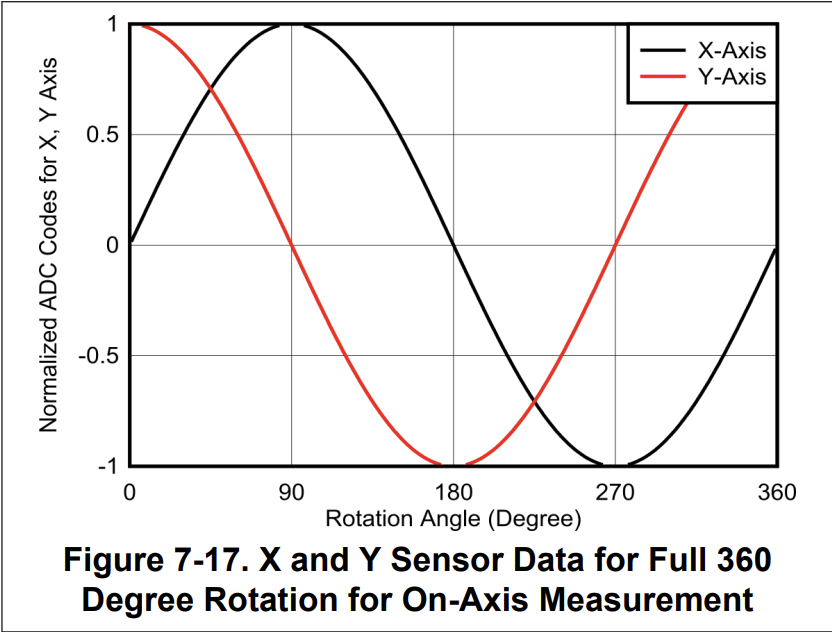

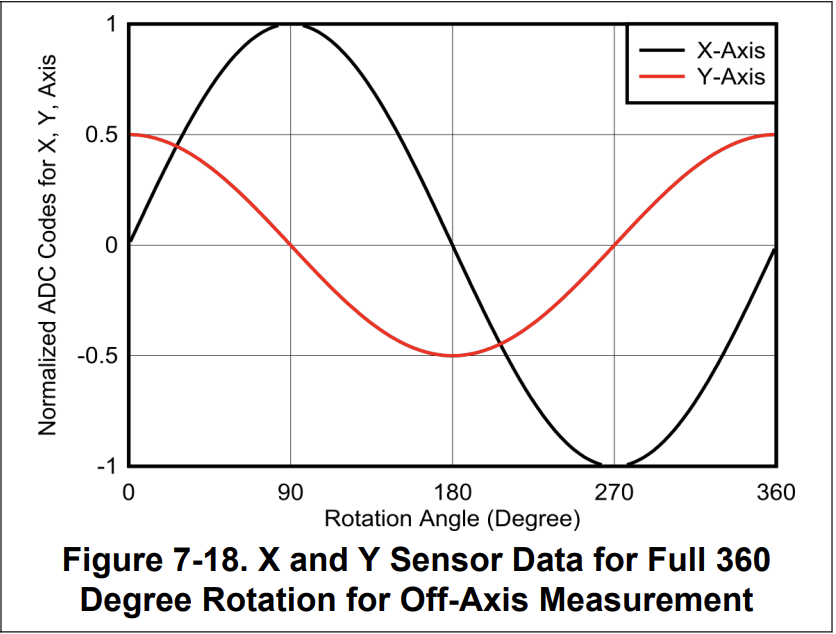

### 7.3 Best Design Practices

The TMAG5273 updates the result registers at the end of a conversion. I²C read of the result register needs to be synchronized with the conversion update time to avoid reading a result data while the result register is being updated. For applications with tight timing budget use the INT̅ signal to notify the primary when a conversion is complete.

### 7.4 Power Supply Recommendations

A decoupling capacitor close to the device must be used to provide local energy with minimal inductance. TI recommends using a ceramic capacitor with a value of at least 0.01µF. Connect the TEST pin to ground.

### 7.5 Layout

#### 7.5.1 Layout Guidelines

Magnetic fields pass through most nonferromagnetic materials with no significant disturbance. Embedding Hall effect sensors within plastic or aluminum enclosures and sensing magnets on the outside is common practice. Magnetic fields also easily pass through most printed-circuit boards (PCBs), which makes placing the magnet on the opposite side of the PCB possible.

#### 7.5.2 Layout Example

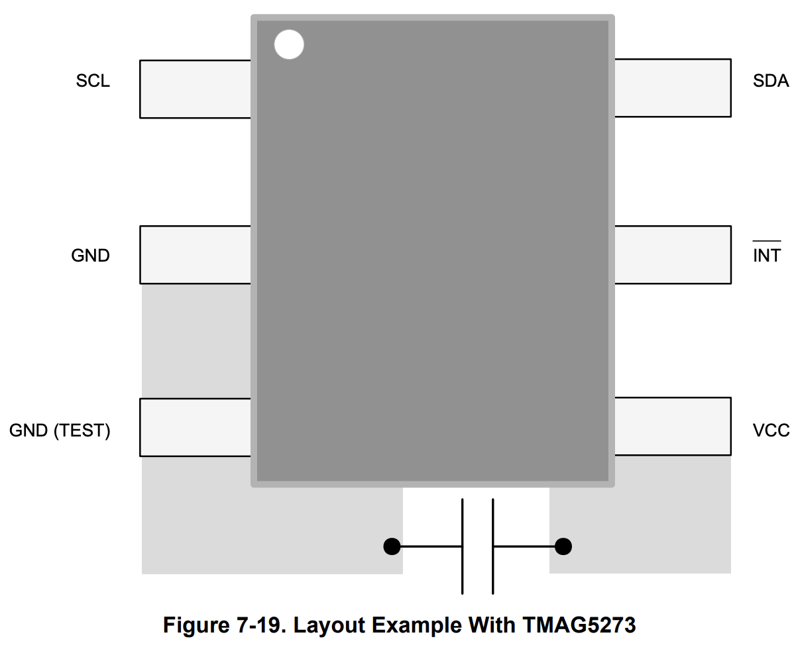

---

## 8 Register Maps

### 8.1 TMAG5273 Registers

Table 8-1 lists the TMAG5273 registers. All register offset addresses not listed in Table 8-1 should be considered as reserved locations and the register contents should not be modified.

User Configuration Registers

**Table 8-1. TMAG5273 Registers**

| Offset | Acronym             | Register Name                    |
| ------ | ------------------- | -------------------------------- |
| 0h     | DEVICE_CONFIG_1     | Configure Device Operation Modes |
| 1h     | DEVICE_CONFIG_2     | Configure Device Operation Modes |
| 2h     | SENSOR_CONFIG_1     | Sensor Device Operation Modes    |
| 3h     | SENSOR_CONFIG_2     | Sensor Device Operation Modes    |
| 4h     | X_THR_CONFIG        | X Threshold Configuration        |
| 5h     | Y_THR_CONFIG        | Y Threshold Configuration        |
| 6h     | Z_THR_CONFIG        | Z Threshold Configuration        |
| 7h     | T_CONFIG            | Temp Sensor Configuration        |
| 8h     | INT_CONFIG_1        | Configure Device Operation Modes |
| 9h     | MAG_GAIN_CONFIG     | Configure Device Operation Modes |
| Ah     | MAG_OFFSET_CONFIG_1 | Configure Device Operation Modes |
| Bh     | MAG_OFFSET_CONFIG_2 | Configure Device Operation Modes |
| Ch     | I2C_ADDRESS         | I²C Address Register             |
| Dh     | DEVICE_ID           | ID for the device die            |
| Eh     | MANUFACTURER_ID_LSB | Manufacturer ID lower byte       |
| Fh     | MANUFACTURER_ID_MSB | Manufacturer ID upper byte       |
| 10h    | T_MSB_RESULT        | Conversion Result Register       |
| 11h    | T_LSB_RESULT        | Conversion Result Register       |
| 12h    | X_MSB_RESULT        | Conversion Result Register       |
| 13h    | X_LSB_RESULT        | Conversion Result Register       |
| 14h    | Y_MSB_RESULT        | Conversion Result Register       |
| 15h    | Y_LSB_RESULT        | Conversion Result Register       |
| 16h    | Z_MSB_RESULT        | Conversion Result Register       |
| 17h    | Z_LSB_RESULT        | Conversion Result Register       |
| 18h    | CONV_STATUS         | Conversion Status Register       |
| 19h    | ANGLE_RESULT_MSB    | Conversion Result Register       |
| 1Ah    | ANGLE_RESULT_LSB    | Conversion Result Register       |
| 1Bh    | MAGNITUDE_RESULT    | Conversion Result Register       |
| 1Ch    | DEVICE_STATUS       | Device_Diag Status Register      |

Complex bit access types are encoded to fit into small table cells. Table 8-2 shows the codes that are used for access types in this section.

**Table 8-2. TMAG5273 Access Type Codes**

| Access Type            | Code | Description                            |
| ---------------------- | ---- | -------------------------------------- |
| Read Type              |      |                                        |
| R                      | R    | Read                                   |
| Write Type             |      |                                        |
| W                      | W    | Write                                  |
| W1CP                   | W    | Write                                  |
| W1CP                   | 1C   | 1 to clear                             |
| W1CP                   | P    | Requires privileged access             |
| Reset or Default Value |      |                                        |
| -n                     |      | Value after reset or the default value |

#### 8.1.1 DEVICE_CONFIG_1 Register (Offset = 0h) [Reset = 0h]

DEVICE_CONFIG_1 is shown in Table 8-3.

| Bit | Field      | Type | Reset | Description                                                                                                                                                                                                                             |
| --- | ---------- | ---- | ----- | --------------------------------------------------------------------------------------------------------------------------------------------------------------------------------------------------------------------------------------- |
| 7   | CRC_EN     | R/W  | 0h    | Enables I²C CRC byte to be sent. 0h = CRC disabled, 1h = CRC enabled                                                                                                                                                                    |
| 6-5 | MAG_TEMPCO | R/W  | 0h    | Temperature coefficient of the magnet. 0h = 0% (No temperature compensation), 1h = 0.12%/deg C (NdBFe), 2h = Reserved, 3h = 0.2%/deg C (Ceramic)                                                                                        |
| 4-2 | CONV_AVG   | R/W  | 0h    | Enables additional sampling of the sensor data to reduce the noise effect. 0h = 1x average (10.0-kSPS 3-axes / 20-kSPS 1 axis), 1h = 2x average, 2h = 4x average, 3h = 8x average, 4h = 16x average, 5h = 32x average                   |
| 1-0 | I2C_RD     | R/W  | 0h    | Defines the I²C read mode. 0h = Standard I²C 3-byte read command, 1h = 1-byte I²C read command for 16bit sensor data and conversion status, 2h = 1-byte I²C read command for 8 bit sensor MSB data and conversion status, 3h = Reserved |

#### 8.1.2 DEVICE_CONFIG_2 Register (Offset = 1h) [Reset = 0h]

| Bit | Field             | Type | Reset | Description                                                                                                                                                                                                                                                                            |
| --- | ----------------- | ---- | ----- | -------------------------------------------------------------------------------------------------------------------------------------------------------------------------------------------------------------------------------------------------------------------------------------- |
| 7-5 | THR_HYST          | R/W  | 0h    | Select thresholds for the interrupt function. 0h = Takes the 2's complement value of each x_THR_CONFIG register to create a magnetic threshold. 1h = Takes the 7 LSB bits of the x_THR_CONFIG register to create two opposite magnetic thresholds of equal magnitude. 2h-7h = Reserved |
| 4   | LP_LN             | R/W  | 0h    | Selects the modes between low active current or low-noise modes. 0h = Low active current mode, 1h = Low noise mode                                                                                                                                                                     |
| 3   | I2C_GLITCH_FILTER | R/W  | 0h    | I²C glitch filter. 0h = Glitch filter on, 1h = Glitch filter off                                                                                                                                                                                                                       |
| 2   | TRIGGER_MODE      | R/W  | 0h    | Selects a condition which initiates a single conversion. 0h = Conversion Start at I²C Command Bits (DEFAULT), 1h = Conversion starts through trigger signal at INT̅ pin                                                                                                                 |
| 1-0 | OPERATING_MODE    | R/W  | 0h    | Selects Operating Mode. 0h = Standby mode, 1h = Sleep mode, 2h = Continuous measure mode, 3h = Wake-up and sleep mode (W&S mode)                                                                                                                                                       |

#### 8.1.3 SENSOR_CONFIG_1 Register (Offset = 2h) [Reset = 0h]

| Bit | Field     | Type | Reset | Description                                                                                                                                                                                                                                   |
| --- | --------- | ---- | ----- | --------------------------------------------------------------------------------------------------------------------------------------------------------------------------------------------------------------------------------------------- |
| 7-4 | MAG_CH_EN | R/W  | 0h    | Enables data acquisition of the magnetic axis channel(s). 0h = All off (DEFAULT), 1h = X, 2h = Y, 3h = X,Y, 4h = Z, 5h = Z,X, 6h = Y,Z, 7h = X,Y,Z, 8h = XYX, 9h = YXY, Ah = YZY, Bh = XZX, Ch-Fh = Reserved                                  |
| 3-0 | SLEEPTIME | R/W  | 0h    | Selects the time spent in low power mode between conversions when OPERATING_MODE =11b. 0h = 1ms, 1h = 5ms, 2h = 10ms, 3h = 15ms, 4h = 20ms, 5h = 30ms, 6h = 50ms, 7h = 100ms, 8h = 500ms, 9h = 1000ms, Ah = 2000ms, Bh = 5000ms, Ch = 20000ms |

#### 8.1.4 SENSOR_CONFIG_2 Register (Offset = 3h) [Reset = 0h]

| Bit | Field       | Type | Reset | Description                                                                                                    |
| --- | ----------- | ---- | ----- | -------------------------------------------------------------------------------------------------------------- |
| 7   | RESERVED    | R    | 0h    | Reserved                                                                                                       |
| 6   | THRX_COUNT  | R/W  | 0h    | Number of threshold crossings before the interrupt is asserted. 0h = 1, 1h = 4                                 |
| 5   | MAG_THR_DIR | R/W  | 0h    | Selects the direction of threshold check. 0h = field above the threshold, 1h = field below the threshold       |
| 4   | MAG_GAIN_CH | R/W  | 0h    | Selects the axis for magnitude gain correction. 0h = 1st channel, 1h = 2nd channel                             |
| 3-2 | ANGLE_EN    | R/W  | 0h    | Enables angle calculation. 0h = No angle calculation, 1h = X 1st Y 2nd, 2h = Y 1st Z 2nd, 3h = X 1st Z 2nd     |
| 1   | X_Y_RANGE   | R/W  | 0h    | Select the X and Y axes magnetic range. 0h = ±40mT (A1) or ±133mT (A2) DEFAULT, 1h = ±80mT (A1) or ±266mT (A2) |
| 0   | Z_RANGE     | R/W  | 0h    | Select the Z axis magnetic range. 0h = ±40mT (A1) or ±133mT (A2) DEFAULT, 1h = ±80mT (A1) or ±266mT (A2)       |

#### 8.1.5 X_THR_CONFIG Register (Offset = 4h) [Reset = 0h]

| Bit | Field        | Type | Reset | Description                                                                                                                                                                                                               |
| --- | ------------ | ---- | ----- | ------------------------------------------------------------------------------------------------------------------------------------------------------------------------------------------------------------------------- |
| 7-0 | X_THR_CONFIG | R/W  | 0h    | 8-bit, 2's complement X axis threshold code for limit check. Range: +/-128. Threshold (mT) for A1: (40(1+X_Y_RANGE)/128)*X_THR_CONFIG, for A2: (133(1+X_Y_RANGE)/128)*X_THR_CONFIG. Default 0h = no threshold comparison. |

#### 8.1.6 Y_THR_CONFIG Register (Offset = 5h) [Reset = 0h]

| Bit | Field        | Type | Reset | Description                                                                                               |
| --- | ------------ | ---- | ----- | --------------------------------------------------------------------------------------------------------- |
| 7-0 | Y_THR_CONFIG | R/W  | 0h    | 8-bit, 2's complement Y axis threshold code for limit check. Range: +/-128. Same formula as X_THR_CONFIG. |

#### 8.1.7 Z_THR_CONFIG Register (Offset = 6h) [Reset = 0h]

| Bit | Field        | Type | Reset | Description                                                                                                                                                                     |
| --- | ------------ | ---- | ----- | ------------------------------------------------------------------------------------------------------------------------------------------------------------------------------- |
| 7-0 | Z_THR_CONFIG | R/W  | 0h    | 8-bit, 2's complement Z axis threshold code for limit check. Range: +/-128. Threshold (mT) for A1: (40(1+Z_RANGE)/128)*Z_THR_CONFIG, for A2: (133(1+Z_RANGE)/128)*Z_THR_CONFIG. |

#### 8.1.8 T_CONFIG Register (Offset = 7h) [Reset = 0h]

| Bit | Field        | Type | Reset | Description                                                                                                                                                 |
| --- | ------------ | ---- | ----- | ----------------------------------------------------------------------------------------------------------------------------------------------------------- |
| 7-1 | T_THR_CONFIG | R/W  | 0h    | Temperature threshold code. Valid range: -41C to 170C (threshold codes: -41C = 1Ah, 170C = 34h). Resolution: 8°C/LSB. Default 0h = no threshold comparison. |
| 0   | T_CH_EN      | R/W  | 0h    | Enables temperature channel. 0h = disabled, 1h = enabled                                                                                                    |

#### 8.1.9 INT_CONFIG_1 Register (Offset = 8h) [Reset = 0h]

| Bit | Field      | Type | Reset | Description                                                                                                                                                                  |
| --- | ---------- | ---- | ----- | ---------------------------------------------------------------------------------------------------------------------------------------------------------------------------- |
| 7   | RSLT_INT   | R/W  | 0h    | Enable interrupt response on conversion complete. 0h = not asserted, 1h = asserted when conversions complete                                                                 |
| 6   | THRSLD_INT | R/W  | 0h    | Enable interrupt response on threshold cross. 0h = not asserted, 1h = asserted when threshold crossed                                                                        |
| 5   | INT_STATE  | R/W  | 0h    | INT̅ interrupt latched or pulsed. 0h = latched until clear, 1h = pulse for 10us                                                                                               |
| 4-2 | INT_MODE   | R/W  | 0h    | Interrupt mode select. 0h = No interrupt, 1h = through INT̅, 2h = through INT̅ except when I²C busy, 3h = through SCL, 4h = through SCL except when I²C busy, 5h-7h = Reserved |
| 1   | RESERVED   | R    | 0h    | Reserved                                                                                                                                                                     |
| 0   | MASK_INTB  | R/W  | 0h    | Mask INT̅ pin when INT̅ connected to GND. 0h = INT̅ enabled, 1h = INT̅ disabled                                                                                                  |

#### 8.1.10 MAG_GAIN_CONFIG Register (Offset = 9h) [Reset = 0h]

| Bit | Field      | Type | Reset | Description                                                                                                                                                               |
| --- | ---------- | ---- | ----- | ------------------------------------------------------------------------------------------------------------------------------------------------------------------------- |
| 7-0 | GAIN_VALUE | R/W  | 0h    | 8-bit gain value to adjust a Hall axis gain. The binary 8-bit input is interpreted as a fractional value: entered_value_decimal/256. Gain value of 0 is interpreted as 1. |

#### 8.1.11 MAG_OFFSET_CONFIG_1 Register (Offset = Ah) [Reset = 0h]

| Bit | Field            | Type | Reset | Description                                                       |
| --- | ---------------- | ---- | ----- | ----------------------------------------------------------------- |
| 7-0 | OFFSET_VALUE_1ST | R/W  | 0h    | 8-bit, 2's complement offset value for first axis. Range: +/-128. |

#### 8.1.12 MAG_OFFSET_CONFIG_2 Register (Offset = Bh) [Reset = 0h]

| Bit | Field            | Type | Reset | Description                                                        |
| --- | ---------------- | ---- | ----- | ------------------------------------------------------------------ |
| 7-0 | OFFSET_VALUE_2ND | R/W  | 0h    | 8-bit, 2's complement offset value for second axis. Range: +/-128. |

#### 8.1.13 I2C_ADDRESS Register (Offset = Ch) [Reset = 6Ah]

| Bit | Field                 | Type | Reset | Description                                                                                                             |
| --- | --------------------- | ---- | ----- | ----------------------------------------------------------------------------------------------------------------------- |
| 7-1 | I2C_ADDRESS           | R/W  | 35h   | 7-bit default factory I²C address. Change these bits for a new I²C address (must be written again at each power cycle). |
| 0   | I2C_ADDRESS_UPDATE_EN | R/W  | 0h    | Enable a new user defined I²C address. 0h = Disable update, 1h = Enable update with bits (7:1)                          |

#### 8.1.14 DEVICE_ID Register (Offset = Dh) [Reset = xh]

| Bit | Field    | Type | Reset | Description                                                                                                          |
| --- | -------- | ---- | ----- | -------------------------------------------------------------------------------------------------------------------- |
| 7-2 | RESERVED | R    | xh    | Reserved                                                                                                             |
| 1-0 | VER      | R    | xh    | Device version indicator. 0h = Reserved, 1h = ±40-mT and ±80-mT range, 2h = ±133-mT and ±266-mT range, 3h = Reserved |

#### 8.1.15 MANUFACTURER_ID_LSB Register (Offset = Eh) [Reset = 49h]

| Bit | Field                 | Type | Reset | Description                  |
| --- | --------------------- | ---- | ----- | ---------------------------- |
| 7-0 | MANUFACTURER*ID*[7:0] | R    | 49h   | 8-bit unique manufacturer ID |

#### 8.1.16 MANUFACTURER_ID_MSB Register (Offset = Fh) [Reset = 54h]

| Bit | Field                  | Type | Reset | Description                  |
| --- | ---------------------- | ---- | ----- | ---------------------------- |
| 7-0 | MANUFACTURER*ID*[15:8] | R    | 54h   | 8-bit unique manufacturer ID |

#### 8.1.17 T_MSB_RESULT Register (Offset = 10h) [Reset = 0h]

**Table 8-19. T_MSB_RESULT Register Field Descriptions**

| Bit | Field              | Type | Reset | Description                                    |
| --- | ------------------ | ---- | ----- | ---------------------------------------------- |
| 7-0 | T_CH_RESULT [15:8] | R    | 0h    | T-channel data conversion results, MSB 8 bits. |

---

#### 8.1.18 T_LSB_RESULT Register (Offset = 11h) [Reset = 0h]

**Table 8-20. T_LSB_RESULT Register Field Descriptions**

| Bit | Field             | Type | Reset | Description                                    |
| --- | ----------------- | ---- | ----- | ---------------------------------------------- |
| 7-0 | T_CH_RESULT [7:0] | R    | 0h    | T-channel data conversion results, LSB 8 bits. |

#### 8.1.19 X_MSB_RESULT Register (Offset = 12h) [Reset = 0h]

**Table 8-21. X_MSB_RESULT Register Field Descriptions**

| Bit | Field              | Type | Reset | Description                                    |
| --- | ------------------ | ---- | ----- | ---------------------------------------------- |
| 7-0 | X_CH_RESULT [15:8] | R    | 0h    | X-channel data conversion results, MSB 8 bits. |

#### 8.1.20 X_LSB_RESULT Register (Offset = 13h) [Reset = 0h]

**Table 8-22. X_LSB_RESULT Register Field Descriptions**

| Bit | Field             | Type | Reset | Description                                    |
| --- | ----------------- | ---- | ----- | ---------------------------------------------- |
| 7-0 | X_CH_RESULT [7:0] | R    | 0h    | X-channel data conversion results, LSB 8 bits. |

#### 8.1.21 Y_MSB_RESULT Register (Offset = 14h) [Reset = 0h]

**Table 8-23. Y_MSB_RESULT Register Field Descriptions**

| Bit | Field              | Type | Reset | Description                                    |
| --- | ------------------ | ---- | ----- | ---------------------------------------------- |
| 7-0 | Y_CH_RESULT [15:8] | R    | 0h    | Y-channel data conversion results, MSB 8 bits. |

#### 8.1.22 Y_LSB_RESULT Register (Offset = 15h) [Reset = 0h]

**Table 8-24. Y_LSB_RESULT Register Field Descriptions**

| Bit | Field             | Type | Reset | Description                                    |
| --- | ----------------- | ---- | ----- | ---------------------------------------------- |
| 7-0 | Y_CH_RESULT [7:0] | R    | 0h    | Y-channel data conversion results, LSB 8 bits. |

#### 8.1.23 Z_MSB_RESULT Register (Offset = 16h) [Reset = 0h]

**Table 8-25. Z_MSB_RESULT Register Field Descriptions**

| Bit | Field              | Type | Reset | Description                                    |
| --- | ------------------ | ---- | ----- | ---------------------------------------------- |
| 7-0 | Z_CH_RESULT [15:8] | R    | 0h    | Z-channel data conversion results, MSB 8 bits. |

#### 8.1.24 Z_LSB_RESULT Register (Offset = 17h) [Reset = 0h]

**Table 8-26. Z_LSB_RESULT Register Field Descriptions**

| Bit | Field             | Type | Reset | Description                                    |
| --- | ----------------- | ---- | ----- | ---------------------------------------------- |
| 7-0 | Z_CH_RESULT [7:0] | R    | 0h    | Z-channel data conversion results, LSB 8 bits. |

#### 8.1.25 CONV_STATUS Register (Offset = 18h) [Reset = 10h]

| Bit | Field         | Type   | Reset | Description                                                                                                                                                                      |
| --- | ------------- | ------ | ----- | -------------------------------------------------------------------------------------------------------------------------------------------------------------------------------- |
| 7-5 | SET_COUNT     | R      | 0h    | Rolling Count of Conversion Data Sets                                                                                                                                            |
| 4   | POR           | R/W1CP | 1h    | Device powered up, or experienced power-on-reset. Clear by writing 1. 0h = No POR, 1h = POR occurred                                                                             |
| 3-2 | RESERVED      | R      | 0h    | Reserved                                                                                                                                                                         |
| 1   | DIAG_STATUS   | R      | 0h    | Detect any internal diagnostics fail (VCC UV, internal memory CRC error, INT̅ pin error, internal clock error). Ignore if V_CC < 2.3V. 0h = No diag fail, 1h = Diag fail detected |
| 0   | RESULT_STATUS | R      | 0h    | Conversion data buffer ready. 0h = not complete, 1h = complete                                                                                                                   |

#### 8.1.26 ANGLE_RESULT_MSB Register (Offset = 19h) [Reset = 0h]

| Bit | Field            | Type | Reset | Description                                                                                                                  |
| --- | ---------------- | ---- | ----- | ---------------------------------------------------------------------------------------------------------------------------- |
| 7-0 | ANGLE_RESULT_MSB | R    | 0h    | Angle measurement result in degree (0 to 360) in 13 LSB bits after combining MSB and LSB. 4 LSB bits for fraction (xxxx/16). |

#### 8.1.27 ANGLE_RESULT_LSB Register (Offset = 1Ah) [Reset = 0h]

| Bit | Field            | Type | Reset | Description                           |
| --- | ---------------- | ---- | ----- | ------------------------------------- |
| 7-0 | ANGLE_RESULT_LSB | R    | 0h    | Angle measurement result LSB portion. |

#### 8.1.28 MAGNITUDE_RESULT Register (Offset = 1Bh) [Reset = 0h]

| Bit | Field            | Type | Reset | Description                                                              |
| --- | ---------------- | ---- | ----- | ------------------------------------------------------------------------ |
| 7-0 | MAGNITUDE_RESULT | R    | 0h    | Resultant vector magnitude. Should be constant during 360° measurements. |

#### 8.1.29 DEVICE_STATUS Register (Offset = 1Ch) [Reset = 10h]

| Bit | Field      | Type   | Reset | Description                                                            |
| --- | ---------- | ------ | ----- | ---------------------------------------------------------------------- |
| 7-5 | RESERVED   | R      | 0h    | Reserved                                                               |
| 4   | INTB_RB    | R      | 1h    | Level the device reads from INT̅ pin. 0h = driven low, 1h = status high |
| 3   | OSC_ER     | R/W1CP | 0h    | Oscillator error detected. Clear by writing 1.                         |
| 2   | INT_ER     | R/W1CP | 0h    | INT̅ pin error detected. Clear by writing 1.                            |
| 1   | OTP_CRC_ER | R/W1CP | 0h    | OTP CRC error detected. Clear by writing 1.                            |
| 0   | VCC_UV_ER  | R/W1CP | 0h    | VCC undervoltage detected. Clear by writing 1. Ignore if V_CC < 2.3V.  |

---

## 9 Device and Documentation Support

### 9.1 Documentation Support

#### 9.1.1 Related Documentation

For related documentation see the following:

- Texas Instruments, [HALL-ADAPTER-EVM User's Guide](https://www.ti.com/lit/pdf/SNAU268)
- Texas Instruments, [TMAG5173 Evaluation Manual](https://www.ti.com/lit/pdf/SNAU267) user's guide
- Texas Instruments, [Angle Measurement With Multi-Axis Linear Hall-Effect Sensors](https://www.ti.com/lit/pdf/SLYA057) application note
- Texas Instruments, [Absolute Angle Measurements for Rotational Motion Using Hall-Effect Sensors](https://www.ti.com/lit/pdf/SLYA056) application brief
- Texas Instruments, [Limit Detection for Tamper and End-of-Travel Detection Using Hall-Effect Sensors](https://www.ti.com/lit/pdf/SLYA058) application brief

### 9.2 Receiving Notification of Documentation Updates

To receive notification of documentation updates, navigate to the device product folder on [ti.com](https://www.ti.com). Click on _Notifications_ to register and receive a weekly digest of any product information that has changed. For change details, review the revision history included in any revised document.

### 9.3 Support Resources

[TI E2E™ support forums](https://e2e.ti.com) are an engineer's go-to source for fast, verified answers and design help — straight from the experts. Search existing answers or ask your own question to get the quick design help you need.

Linked content is provided "AS IS" by the respective contributors. They do not constitute TI specifications and do not necessarily reflect TI's views; see TI's [Terms of Use](https://www.ti.com/corp/docs/legal/termsofuse.shtml).

### 9.4 Trademarks

TI E2E™ is a trademark of Texas Instruments.
All trademarks are the property of their respective owners.

### 9.5 Electrostatic Discharge Caution

This integrated circuit can be damaged by ESD. Texas Instruments recommends that all integrated circuits be handled with appropriate precautions. Failure to observe proper handling and installation procedures can cause damage.

ESD damage can range from subtle performance degradation to complete device failure. Precision integrated circuits may be more susceptible to damage because very small parametric changes could cause the device not to meet its published specifications.

### 9.6 Glossary

[TI Glossary](https://www.ti.com/lit/pdf/SLYZ022) — This glossary lists and explains terms, acronyms, and definitions.
